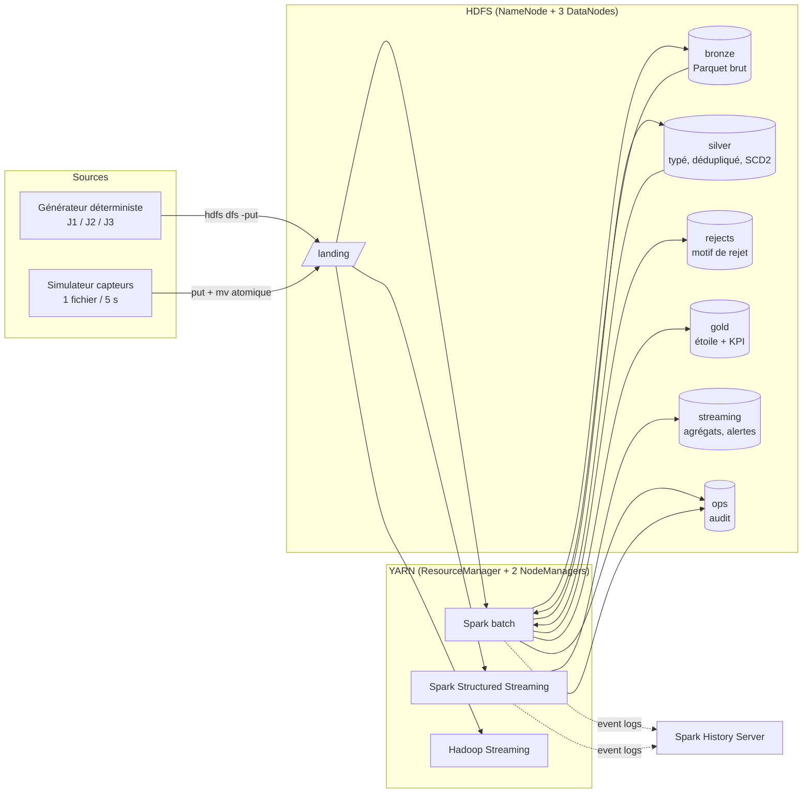

# Architecture cible

Plateforme de pilotage logistique et industriel de GlobalTech Industries : un data lake HDFS en
trois couches (bronze, silver, gold) alimenté par des dépôts batch quotidiens et par un flux
d'événements capteurs, traité par Spark sur YARN.

Ce document est la référence de conception. Les décisions structurantes sont détaillées dans
[`docs/adr/`](adr/). Le format exact des données sources est fixé par le
[contrat de données](data-contract.md) et le modèle cible par le [modèle de données](data-model.md).

## Vue d'ensemble



## Composants

| Composant | Rôle | Instances |
| --- | --- | --- |
| NameNode | Métadonnées HDFS, ACL, quotas, politiques d'erasure coding | 1 |
| DataNode | Stockage des blocs | 3 (minimum pour réplication 3 et EC `XOR-2-1`) |
| ResourceManager | Ordonnancement YARN | 1 |
| NodeManager | Exécution des conteneurs Spark et MapReduce | 2 |
| Spark History Server | Historique des applications Spark (`hdfs:///spark-logs`) | 1 |
| MapReduce JobHistory | Historique et compteurs des jobs MapReduce | 1 |
| Client (edge) | `spark-submit`, `hdfs`, `yarn`, générateur. Conteneur éphémère qui monte le dépôt courant | à la demande |

Versions : Hadoop 3.3.6, Spark 3.5.3 (build `without-hadoop`, branché sur le classpath Hadoop du
cluster), Python 3.11, Java 11. Voir [ADR-0001](adr/0001-image-hadoop-spark.md). Le budget mémoire
(tas de chaque démon, mémoire et vcores des NodeManagers, taille des exécuteurs) est calculé dans
le guide de la plateforme : Docker dispose de 15 444 Mio, alors que les valeurs par défaut de
Hadoop 3.3.6 feraient annoncer 8 Gio à chaque NodeManager.

## Arborescence HDFS

```
/datalake
├── landing/<source>/ingestion_date=YYYY-MM-DD/   fichiers déposés tels quels (CSV, log, JSON)
├── landing/sensors/incoming/                     fichiers capteurs surveillés par le streaming
├── bronze/<source>/ingestion_date=YYYY-MM-DD/    Parquet, colonnes brutes en string + métadonnées
├── silver/<entité>/                              données typées et fiables
├── silver/rejects/<source>/ingestion_date=…/     lignes rejetées + motifs
├── gold/<table>/                                 modèle en étoile et indicateurs
├── gold/sensor_aggregates/, gold/sensor_alerts/  agrégats et alertes du flux capteurs
├── streaming/{checkpoints,rejects}/              état technique du streaming
└── ops/audit/                                    table d'audit des exécutions
/spark-logs                                       event logs Spark (History Server)
/benchmarks                                       jeux de mesure (réplication contre EC)
```

`<source>` ∈ `orders`, `customers`, `products`, `weblogs`.

Justification :

- **Une racine par couche** : les droits, quotas et politiques de stockage s'appliquent à un
  répertoire. Séparer les couches permet de donner l'écriture à l'ETL et la seule lecture de
  `gold` aux analystes.
- **Partition `ingestion_date` en landing et bronze** : c'est la clé de rejeu. Rejouer un jour
  réécrit exactement une partition, d'où l'absence de doublon (voir [ADR-0002](adr/0002-parquet-idempotence.md)).
- **Partitions métier en gold** (`order_date`) : les requêtes analytiques filtrent par date de
  commande, pas par date d'arrivée.

### Droits et quotas

| Chemin | Propriétaire | Mode | ACL | Quota espace |
| --- | --- | --- | --- | --- |
| `/datalake/landing` | `etl:datalake` | `770` | — | 20 Go |
| `/datalake/bronze` | `etl:datalake` | `750` | — | 30 Go |
| `/datalake/silver` | `etl:datalake` | `750` | `group:analysts:r-x` sur les entités pseudonymisées | 30 Go |
| `/datalake/gold` | `etl:datalake` | `755` | `group:analysts:r-x` (défaut hérité) | 10 Go |
| `/datalake/streaming` | `etl:datalake` | `750` | — | 5 Go |
| `/datalake/ops` | `etl:datalake` | `750` | `group:ops:r-x` | 2 Go |
| `/spark-logs` | `spark:hadoop` | `1777` | — | 5 Go |
| `/benchmarks` | `etl:datalake` | `755` | — | 20 Go |

Les quotas d'espace HDFS comptent l'espace physique (réplication incluse) : 30 Go de quota pour
la couche bronze correspondent à 10 Go logiques en réplication 3.

## Flux batch

Pour chaque jour d'ingestion `D` (J1 = 2026-01-01, J2 = 2026-01-02, J3 = 2026-01-03) :

1. **Dépôt** : `scripts/cluster/land.sh <dépôt> D` vérifie le dépôt local du générateur contre
   son manifeste, puis le publie vers `/datalake/landing/<source>/ingestion_date=D/` en remplaçant
   le landing précédent de `D` d'un bloc ([guide de la plateforme](platform.md#déposer-un-jour-de-données)).
2. **Bronze** : lecture de chaque fichier avec un schéma tout en `string` dérivé de son en-tête
   (aucune perte, changement de schéma toléré, [ADR-0007](adr/0007-evolution-schema.md)), ajout de
   `_ingested_at`, `_source_file`, `_run_id`, `_record_hash`, `_corrupt_record`. Écriture Parquet
   dans la partition `ingestion_date=D`, remplacée en entier.
3. **Silver** ([règles et disposition](data-model.md#règles-de-qualité-et-disposition)) :
   - doublons exacts, contrôles qualité en une seule projection (registre de règles), séparation
     propres / rejets, doublons de clé intra-jour et inter-jours ;
   - réconciliation `propres + rejets + doublons = total bronze(D)`, vérifiée à chaque exécution
     et tracée dans l'audit ; l'exécution échoue si l'égalité est fausse ;
   - produits historisés en SCD type 2, clients pseudonymisés, logs web parsés.
4. **Gold** : dimensions et indicateurs recalculés en entier ; fait des ventes au prix applicable
   à la date de commande, dont seules les partitions `order_date` touchées par silver(`D`) sont
   recalculées, à partir de toutes les lignes silver de ces dates.
5. **Audit** : chaque job ajoute une ligne à `/datalake/ops/audit` (identifiant d'exécution,
   application YARN, compteurs, durée, statut).

Chaque étape est idempotente : la rejouer converge vers le même état (voir
[ADR-0002](adr/0002-parquet-idempotence.md) et [ADR-0005](adr/0005-silver-incremental.md)).

## Flux streaming

Le simulateur rejoue les fichiers capteurs pré-générés vers `/datalake/landing/sensors/incoming`
à raison d'un fichier toutes les 5 secondes (écriture dans un répertoire de transit puis `mv`
atomique, pour que Spark ne lise jamais un fichier partiel).

Le job Structured Streaming lit ce répertoire avec un schéma explicite, applique un watermark de
2 minutes sur `event_time`, déduplique par `event_id` dans la limite du watermark, calcule des
agrégats sur des fenêtres d'une minute par machine et métrique (mode `append` : chaque fenêtre est
écrite une fois, définitive), émet une alerte par événement au-delà du seuil, et écrit en
`foreachBatch` vers `gold/sensor_aggregates` et `gold/sensor_alerts` dans des répertoires indexés
par `batch_id`, ce qui rend la réécriture d'un micro-batch rejoué idempotente. Le checkpoint HDFS
permet la reprise après arrêt. Détails mesurés : [ADR-0008](adr/0008-streaming.md).

## Comparaison MapReduce contre Spark (Lot 6)

Un même calcul, deux moteurs, mêmes entrées et mêmes règles :

| Élément | Définition |
| --- | --- |
| Entrée | fichiers CSV de commandes en landing (J1, ou J1 à J3), lus bruts par les deux moteurs |
| Jointure pays | `customer_id` → pays par le référentiel clients : cache distribué (`-files`) et jointure côté map en Hadoop Streaming, jointure diffusée en Spark ; un client sans région (anomalie `MISSING_REGION`, 0,99 % des lignes valides) est compté dans le pays `UNKNOWN` par les deux moteurs, comme en silver |
| Mesure | montant facturé `quantity × unit_price_eur × (1 − discount_pct)` des lignes `COMPLETED` (pas de SCD2, impossible dans un mapper sans état) |
| Lignes invalides | compteurs par motif : nombre de champs différent de 8 ou 9 (le contrat garantit qu'une ligne malformée n'a jamais 8 ni 9 champs), quantité ou prix invalide, horodatage invalide, client vide ou inconnu ; compteurs Hadoop (`reporter:counter:`) contre accumulateurs ou agrégats Spark |
| Comparaison | durée (application YARN), lignes lues (`Map input records` contre métriques d'entrée Spark), lignes de code, résultats identiques au centime |

## Banc de performance (Lot 7)

Indicateur mesuré : CA mensuel par pays et catégorie au prix applicable, soit la jointure
commandes × `products_scd2` × clients puis l'agrégation, sur le profil `full` (10 M de lignes,
`P00042` porte 20 % des lignes synthétiques).

| Version | Réglages |
| --- | --- |
| Naïve | CSV avec `inferSchema`, jointure triée sans diffusion (`autoBroadcastJoinThreshold=-1`), AQE désactivée, 200 partitions de shuffle, aucun cache, sortie CSV gzip |
| Optimisée | leviers ajoutés un par un et mesurés séparément |

Leviers, chacun mesuré contre la version précédente (médiane de 3 exécutions sur YARN, durée,
octets de shuffle, ratio max/médiane des tâches) :

1. format : Parquet contre CSV ;
2. partitionnement : élagage de partitions sur la date contre lecture complète ;
3. skew, deux méthodes comparées : **salage** de la clé chaude, et **AQE skew join** avec seuils
   ajustés ; la jointure diffusée, qui supprime le shuffle, est mesurée comme référence. Le
   diagnostic (ratio max/médiane des enregistrements par tâche) n'est visible qu'avec diffusion et
   AQE désactivées : la revue du Lot 0 a mesuré 49,7 dans ce cas contre 1,4 avec AQE ;
4. cache : seulement pour un DataFrame réutilisé par plusieurs indicateurs, gain mesuré ;
5. nombre de partitions de shuffle : balayage 8, 16, 32, 64, 200, choix par la mesure ;
6. compression : snappy, zstd, gzip (taille et durée).

Trois plans `explain` commentés : jointure triée avec skew, jointure diffusée, jointure salée.
Réplication 3 contre erasure coding : voir [ADR-0006](adr/0006-topologie-hdfs.md).

## Organisation du code

```
src/gtdp/
├── config.py        configuration TOML + surcharges d'environnement
├── log.py           journalisation structurée (JSON)
├── io.py            écritures idempotentes et lectures tolérantes (write_partitions, replace_table, read_table)
├── spark.py         construction de la SparkSession
├── audit.py         table d'audit
├── schemas.py       schémas explicites des sources
├── datagen/         générateur J1/J2/J3 et simulateur capteurs
├── bronze/  silver/  gold/  streaming/  perf/
└── jobs/            points d'entrée spark-submit (registre de jobs)
mapreduce/           mapper et reducer Hadoop Streaming
scripts/             exploitation du cluster
conf/                configuration externalisée
tests/               pytest (Spark local)
```

Les transformations sont des fonctions pures `DataFrame -> DataFrame`, testées en Spark local.
Les jobs sont des coquilles minces qui lisent la configuration, appellent les transformations,
écrivent et tracent l'audit. Les traitements de référence s'exécutent sur YARN.

## Contraintes du sujet et réponse

| Contrainte | Réponse |
| --- | --- |
| Traitements finaux sur YARN | `scripts/submit.sh` soumet en `--master yarn` depuis un client éphémère |
| Pas d'UDF Python si une fonction native existe | Contrôles, parsing de logs (`regexp_extract`), pseudonymisation (`sha2`) en fonctions natives |
| Choix justifiés par une mesure | `docs/benchmarks.md`, `docs/mapreduce-vs-spark.md`, ADR chiffrés |
| Versions du cours | Spark 3.5.3 (celle du kit), Hadoop 3.3.6 |
| Historique Git lisible | Une branche et une PR par story Jira, commits conventionnels référencés `KAN-xx` |
