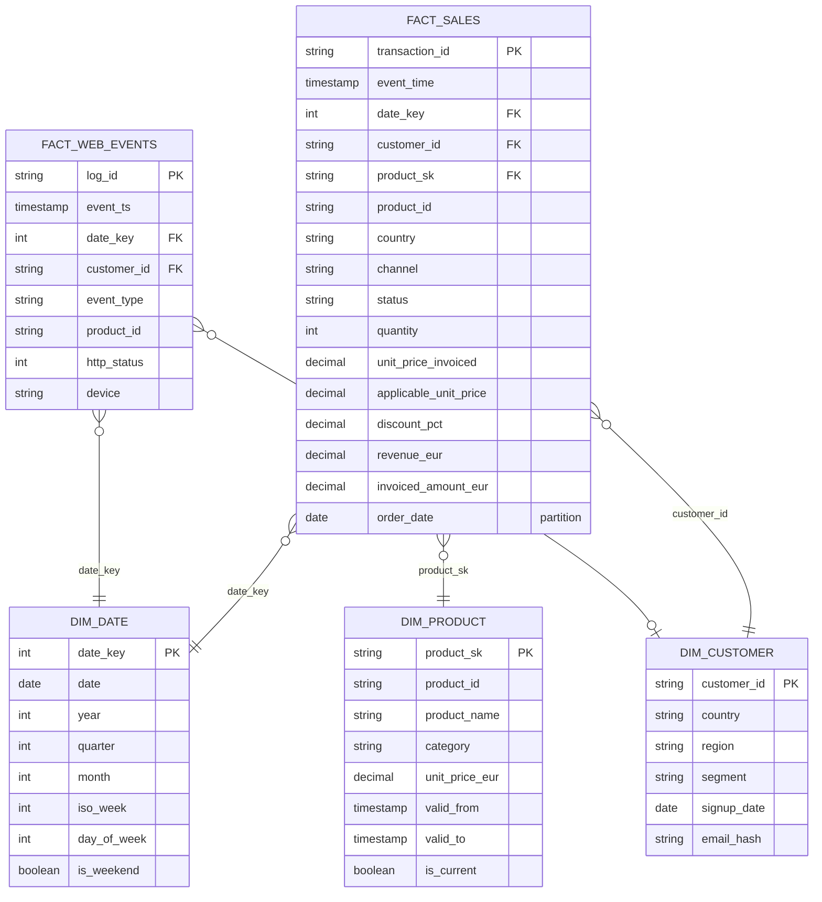

# Modèle de données

Le dictionnaire de données détaillé (chaque colonne, type, règle, exemple) est dans
[`data-dictionary.md`](data-dictionary.md). Ce document fixe les entités, leurs clés, les règles de
qualité et le traitement de chaque anomalie du [contrat de données](data-contract.md).

## Bronze

Une table par source, `bronze/<source>/ingestion_date=YYYY-MM-DD/`. Chaque fichier est lu avec un
schéma tout en `string` dérivé de **son propre en-tête** (voir
[ADR-0007](adr/0007-evolution-schema.md)) : aucun typage, aucune perte, et le changement de schéma
de J3 ne casse pas la lecture. Colonnes ajoutées :

| Colonne | Type | Rôle |
| --- | --- | --- |
| `ingestion_date` | date | colonne de partition, date du dépôt |
| `_ingested_at` | timestamp | horodatage de l'ingestion |
| `_source_file` | string | chemin HDFS du fichier d'origine |
| `_run_id` | string | identifiant de l'exécution (audit) |
| `_record_hash` | string | `sha2` des valeurs brutes de la ligne, sert à la déduplication exacte |
| `_corrupt_record` | string | ligne brute si son nombre de champs diffère de l'en-tête |

## Silver

| Entité | Chemin | Clé | Partition | Historisation |
| --- | --- | --- | --- | --- |
| `orders` | `silver/orders` | `transaction_id` | `ingestion_date` | aucune (fait immuable) |
| `customers` | `silver/customers` | `customer_id` | — | SCD type 1, données personnelles pseudonymisées |
| `products_scd2` | `silver/products_scd2` | `product_id`, `valid_from` | — | SCD type 2 |
| `weblogs` | `silver/weblogs` | `log_id` (hash de la ligne) | `ingestion_date` | aucune |
| `rejects` | `silver/rejects/<source>` | — | `ingestion_date` | une ligne par enregistrement rejeté, liste des motifs, ligne brute |

### Ordre des opérations et réconciliation

Pour chaque source et chaque jour `D` :

1. **doublons exacts** : une seule ligne par `_record_hash` dans le dépôt, les autres sont comptées
   comme doublons ;
2. **contrôles qualité en une seule projection** : un registre de règles (code, condition) produit
   la colonne `reject_reasons` (tableau des codes vérifiés) ; une ligne avec au moins un motif part
   en rejet. Une ligne dont `_corrupt_record` est non nul reçoit le seul motif `MALFORMED_ROW` : ses
   colonnes sont décalées ou nulles, les autres règles ne sont évaluées que sur les lignes bien
   formées (sinon un même enregistrement compterait sous plusieurs codes et la réconciliation par
   code avec le manifeste serait fausse) ;
3. **doublons de clé** dans le dépôt (même clé, contenu différent) : une ligne conservée par clé,
   choisie de façon déterministe, les autres comptées comme doublons ;
4. **doublons inter-jours** (commandes) : clé déjà présente dans une partition silver antérieure
   à `D` (voir [ADR-0005](adr/0005-silver-incremental.md)).

Identité vérifiée à chaque exécution et écrite dans l'audit : `lignes bronze(D) = propres + rejets
+ doublons`. L'exécution échoue si elle est fausse. Une seconde vérification contrôle l'unicité
globale de la clé silver.

Les identifiants de référence (`customer_id`, `product_id` d'une commande) sont contrôlés contre
**tous les identifiants vus en bronze** jusqu'à `D` inclus, lignes rejetées comprises : une
anomalie sur une fiche client ou produit ne rend pas orphelines ses commandes.

### Règles de qualité et disposition

`rejet` = la ligne va dans `rejects` avec le code ; `doublon` = comptée et écartée ; `conservé` =
la ligne reste en silver, éventuellement avec un drapeau dans `quality_flags`.

**Commandes**

| Code du contrat | Règle silver | Disposition |
| --- | --- | --- |
| `DUPLICATE_EXACT` | même `_record_hash` dans le dépôt | doublon |
| `DUPLICATE_CROSS_DAY` | `transaction_id` déjà en silver avant `D` | doublon |
| `NULL_CUSTOMER` | `customer_id` vide | rejet `NULL_CUSTOMER` |
| `UNKNOWN_CUSTOMER` | `customer_id` absent des identifiants clients vus en bronze | rejet `UNKNOWN_CUSTOMER` |
| `UNKNOWN_PRODUCT` | `product_id` absent des identifiants produits vus en bronze | rejet `UNKNOWN_PRODUCT` |
| `BAD_QUANTITY` | non entier ou ≤ 0 | rejet `BAD_QUANTITY` |
| `BAD_PRICE` | non décimal ou ≤ 0 | rejet `BAD_PRICE` |
| `BAD_TIMESTAMP` | non conforme à `yyyy-MM-dd'T'HH:mm:ss` | rejet `BAD_TIMESTAMP` |
| `FUTURE_TIMESTAMP` | `event_time` > `ingestion_date` + 1 jour | rejet `FUTURE_TIMESTAMP` |
| `BAD_ENUM` | `channel` ou `status` hors liste | rejet `BAD_ENUM` |
| `MALFORMED_ROW` | `_corrupt_record` non nul | rejet `MALFORMED_ROW` |
| (J3) `discount_pct` | absent du fichier ou vide → `0.000` ; hors `[0 ; 0,30]` → rejet `BAD_DISCOUNT` | conservé |

**Clients**

| Code du contrat | Règle silver | Disposition |
| --- | --- | --- |
| `DUPLICATE_EXACT` | même `_record_hash` | doublon |
| `DUPLICATE_KEY` | même `customer_id` et même `updated_at` après normalisation de l'email | doublon |
| `MISSING_EMAIL` | email vide | conservé, `email_hash` nul, drapeau `MISSING_EMAIL` |
| `BAD_EMAIL` | `lower(trim(email))` hors `^[^@\s]+@[^@\s]+\.[a-z]{2,}$` | conservé, `email_hash` nul, drapeau `BAD_EMAIL` |
| `MISSING_REGION` | région vide | conservé, `country` = `UNKNOWN`, drapeau `MISSING_REGION` |
| `BAD_DATE` | `signup_date` non ISO | conservé, date relue au format `dd/MM/yyyy` sinon nulle, drapeau `BAD_DATE` |
| (kit) inscription future | `signup_date` > `ingestion_date` | conservé, drapeau `FUTURE_SIGNUP` |
| — | `customer_id` vide ou `_corrupt_record` non nul | rejet (règle défensive, rien d'injecté) |

Une fiche client n'est rejetée que si elle est inexploitable : une adresse email manquante ne fait
pas disparaître un client et son chiffre d'affaires. `customers` garde, par `customer_id`, la ligne
de plus grand `updated_at` vue jusqu'à `D` (SCD type 1).

**Produits**

| Code du contrat | Règle silver | Disposition |
| --- | --- | --- |
| `DUPLICATE_EXACT` | même `_record_hash` | doublon |
| `BAD_PRICE` | prix non décimal ou ≤ 0 | rejet `BAD_PRICE` |
| `NULL_CATEGORY` | catégorie vide | rejet `NULL_CATEGORY` |
| `CONFLICTING_VERSION` | plusieurs lignes distinctes pour (`product_id`, `updated_at`) | rejet du groupe entier, motif `CONFLICTING_VERSION` (2 lignes par anomalie du manifeste) |
| `MALFORMED_ROW` | `_corrupt_record` non nul | rejet `MALFORMED_ROW` |

Le contrat injecte ces anomalies uniquement sur des versions non initiales : la version
précédente du produit reste donc en vigueur.

**Logs web**

| Code du contrat | Règle silver | Disposition |
| --- | --- | --- |
| `MALFORMED_LINE` | ne correspond pas à l'expression du Combined Log Format | rejet `MALFORMED_LINE` |
| `HTTP_404`, `HTTP_500` | lignes valides | conservé |
| — | même `_record_hash` | doublon (rien d'injecté) |

### `products_scd2`

| Colonne | Rôle |
| --- | --- |
| `product_sk` | clé technique de version (`product_id` + `valid_from`) |
| `product_id` | clé métier |
| `product_name`, `category`, `unit_price_eur` | attributs historisés |
| `valid_from` | début de validité (inclus) = `updated_at` de la version, sauf la version 1 |
| `valid_to` | fin de validité (exclue), `9999-12-31` pour la version courante |
| `is_current` | version courante |
| `version` | rang de la version (1, 2, …) |

Règles :

- la table est recalculée à partir de toutes les lignes produits valides de bronze jusqu'à `D`
  (petite volumétrie), puis échangée atomiquement ;
- une nouvelle version n'est créée que si un attribut historisé change ;
- la **version 1 vaut depuis `1900-01-01`** : la première version connue s'applique à toute
  commande antérieure, ce qui garantit exactement un prix par commande (un nouveau produit
  `P01001+` peut être commandé le jour même de son `updated_at`) ;
- unicité vérifiée de (`product_id`, `valid_from`) ; aucun recouvrement d'intervalles.

Le prix applicable à une commande est celui de la version telle que
`valid_from <= event_time < valid_to`.

### Pseudonymisation des clients

| Donnée | Traitement silver | Justification |
| --- | --- | --- |
| `email` | `email_hash = sha2(concat(sel, lower(trim(email))), 256)` | permet le comptage de clients distincts et les jointures sans exposer l'adresse |
| `full_name`, `phone` | supprimés | aucun usage analytique |
| `customer_id` | conservé | identifiant interne, non directement identifiant hors du SI |
| adresse IP (logs) | `ip_hash` salé, `/24` conservé pour la géographie grossière | l'IP est une donnée personnelle (RGPD) |

Le sel vient d'un secret hors dépôt (`GTDP_PSEUDO_SALT`). Il entre dans le calcul comme une
**donnée** (DataFrame d'une ligne diffusé), jamais comme un littéral : il n'apparaît ni dans les
plans `explain` ni dans les event logs servis par le History Server. Un test le vérifie. Voir
[ADR-0004](adr/0004-pseudonymisation.md).

## Gold : modèle en étoile

Grain de `fact_sales` : une ligne de commande, `transaction_id` unique (vérifié).

- `revenue_eur = quantity × applicable_unit_price × (1 − discount_pct)` : chiffre d'affaires au
  prix catalogue applicable à la date de commande (jointure SCD2). `discount_pct` vaut toujours
  une valeur non nulle en silver (0 avant J3).
- `invoiced_amount_eur = quantity × unit_price_invoiced × (1 − discount_pct)` : montant facturé.

**Rafraîchissement** : `fact_sales` est partitionné par `order_date`. Le traitement de `D`
recalcule chaque partition `order_date` présente dans silver(`D`) à partir de **toutes** les lignes
silver de ces dates (toutes partitions `ingestion_date`), puis remplace ces partitions seules. Une
commande retardataire de J2 datée du 2025-12-30 reconstruit la partition du 2025-12-30 avec les
lignes de J1 et de J2. Dimensions et indicateurs sont recalculés en entier et échangés.

## Indicateurs gold

| Table | Indicateur | Mécanisme Spark |
| --- | --- | --- |
| `kpi_revenue_daily` | CA quotidien par pays (commandes `COMPLETED`) | agrégation |
| `kpi_top_products_country` | Top 5 produits par CA et par pays | `dense_rank()` sur fenêtre partitionnée par pays |
| `kpi_revenue_moving_avg` | Moyenne mobile 7 jours du CA quotidien par pays | fenêtre `rowsBetween(-6, 0)` |
| `kpi_price_deviation` | Ratio médian prix facturé / prix applicable, par catégorie et par mois | jointure SCD2 par intervalle, `percentile_approx` |
| `kpi_cancel_return_rate` | Taux d'annulation et de retour par canal et catégorie | agrégation conditionnelle |
| `kpi_avg_basket` | Panier moyen par pays et segment | agrégation |
| `kpi_http_errors_hourly` | Taux de 404 et 500 par heure | agrégation sur `fact_web_events` |
| `kpi_conversion_funnel` | Entonnoir vue → panier → achat par appareil | agrégation conditionnelle |
| `kpi_data_quality` | Rejets par motif et par jour, commandes antérieures à l'inscription | agrégation sur `rejects` et `fact_sales` |

`kpi_price_deviation` prend la médiane, robuste aux lignes du kit dont le prix facturé est
indépendant du catalogue (constat mesuré du contrat) ; sur les lignes synthétiques, le ratio
attendu est compris entre 0,90 et 1,00.

## Agrégats du flux capteurs (gold)

| Sortie | Grain | Clé d'idempotence |
| --- | --- | --- |
| `gold/sensor_aggregates` | fenêtre de 1 min × machine × métrique (min, max, moyenne, nombre) | `batch_id` |
| `gold/sensor_alerts` | un événement au-delà du seuil, après déduplication | `batch_id` |
| `streaming/rejects` | événement illisible ou sans valeur | `batch_id` |

Sémantique (watermark, mode de sortie, reprise) : [ADR-0008](adr/0008-streaming.md).
