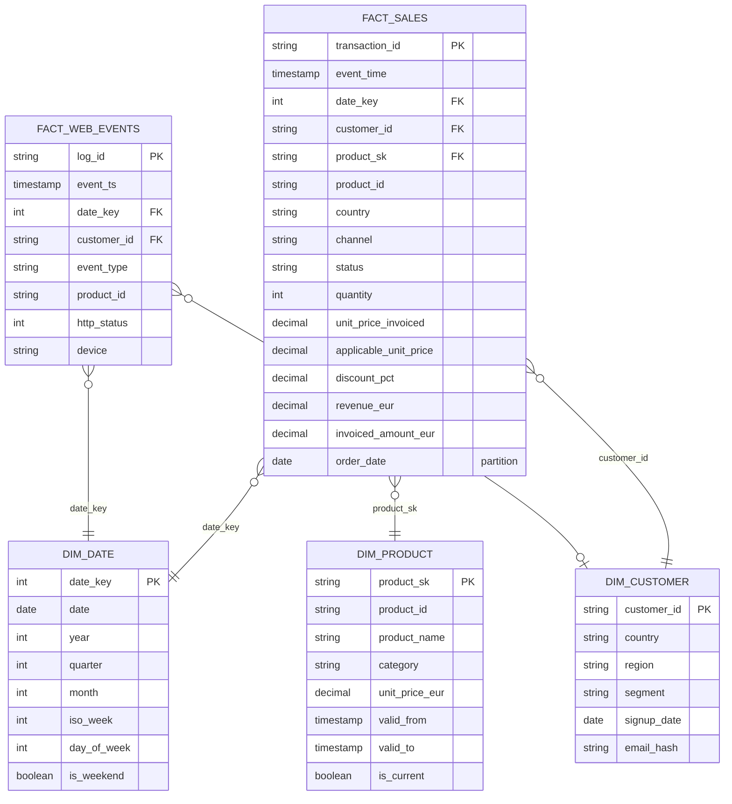

# Modèle de données

Le dictionnaire de données détaillé (chaque colonne, type, règle, exemple) est dans
[`data-dictionary.md`](data-dictionary.md). Ce document fixe les entités et leurs clés.

## Bronze

Une table par source, colonnes brutes du fichier en `string` (aucun typage, aucune perte), plus :

| Colonne | Type | Rôle |
| --- | --- | --- |
| `_ingestion_date` | date | partition, date du dépôt |
| `_ingested_at` | timestamp | horodatage de l'ingestion |
| `_source_file` | string | chemin HDFS du fichier d'origine |
| `_run_id` | string | identifiant de l'exécution (audit) |
| `_record_hash` | string | `sha2` de la ligne brute, sert à la déduplication exacte |
| `_corrupt_record` | string | ligne brute si le nombre de champs est incorrect |

## Silver

| Entité | Clé | Partition | Historisation |
| --- | --- | --- | --- |
| `orders` | `transaction_id` | `ingestion_date` | aucune (fait immuable) |
| `customers` | `customer_id` | — | SCD type 1 (dernière version), données personnelles pseudonymisées |
| `products_scd2` | `product_id`, `valid_from` | — | SCD type 2 |
| `weblogs` | `log_id` (hash de la ligne) | `ingestion_date` | aucune |
| `rejects` | — | `source`, `ingestion_date` | une ligne par enregistrement rejeté avec la liste des motifs |

### `products_scd2`

| Colonne | Rôle |
| --- | --- |
| `product_sk` | clé technique de version (`product_id` + `valid_from`) |
| `product_id` | clé métier |
| `product_name`, `category`, `unit_price_eur` | attributs historisés |
| `valid_from` | début de validité (inclus) = `updated_at` de la version |
| `valid_to` | fin de validité (exclue), `9999-12-31` pour la version courante |
| `is_current` | version courante |
| `version` | rang de la version (1, 2, …) |

Une nouvelle version n'est créée que si un attribut historisé change. Le prix applicable à une
commande est celui de la version telle que `valid_from <= event_time < valid_to`.

### Pseudonymisation des clients

| Donnée | Traitement silver | Justification |
| --- | --- | --- |
| `email` | `email_hash = sha2(concat(sel, lower(trim(email))), 256)` | permet le comptage de clients distincts et les jointures sans exposer l'adresse |
| `full_name`, `phone` | supprimés | aucun usage analytique |
| `customer_id` | conservé | identifiant interne, non directement identifiant hors du SI |
| adresse IP (logs) | `ip_hash` salé, `/24` conservé pour la géographie grossière | l'IP est une donnée personnelle (RGPD) |

Le sel vient d'un secret hors dépôt (`GTDP_PSEUDO_SALT`). Voir [ADR-0004](adr/0004-pseudonymisation.md).

## Gold : modèle en étoile

Grain de `fact_sales` : une ligne de commande. `revenue_eur = quantity × applicable_unit_price ×
(1 − discount_pct)` au prix catalogue applicable ; `invoiced_amount_eur` reprend le prix facturé.
L'écart entre les deux est un indicateur.

## Indicateurs gold

| Table | Indicateur | Mécanisme Spark |
| --- | --- | --- |
| `kpi_revenue_daily` | CA quotidien par pays (commandes `COMPLETED`) | agrégation |
| `kpi_top_products_country` | Top 5 produits par CA et par pays | `dense_rank()` sur fenêtre partitionnée par pays |
| `kpi_revenue_moving_avg` | Moyenne mobile 7 jours du CA quotidien par pays | fenêtre `rowsBetween(-6, 0)` |
| `kpi_price_deviation` | Écart prix facturé contre prix applicable par catégorie | jointure SCD2 par intervalle |
| `kpi_cancel_return_rate` | Taux d'annulation et de retour par canal et catégorie | agrégation conditionnelle |
| `kpi_avg_basket` | Panier moyen par pays et segment | agrégation |
| `kpi_http_errors_hourly` | Taux de 404 et 500 par heure | agrégation sur `fact_web_events` |
| `kpi_conversion_funnel` | Entonnoir vue → panier → achat par appareil | agrégation conditionnelle |

## Streaming

| Sortie | Grain | Clé d'idempotence |
| --- | --- | --- |
| `streaming/sensors/aggregates` | fenêtre de 1 min × machine × métrique (min, max, moyenne, nombre) | `batch_id` |
| `streaming/sensors/alerts` | une alerte par fenêtre et capteur en dépassement | `batch_id` |
| `streaming/sensors/rejects` | événement illisible ou sans valeur | `batch_id` |
