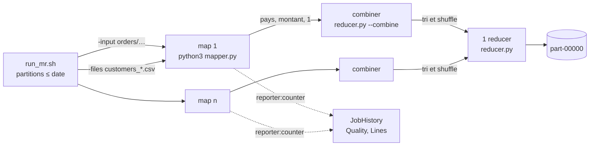
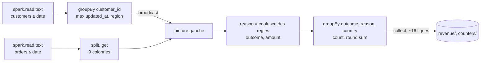

# MapReduce contre Spark (Lot 6)

Le même calcul, le chiffre d'affaires facturé par pays avec un compteur de lignes invalides par
motif, est écrit deux fois : en Hadoop Streaming (mapper et reducer Python) et en Spark. Les deux
programmes lisent les mêmes fichiers bruts du landing et rendent un résultat identique octet pour
octet, vérifié à chaque exécution par un outil de comparaison. Ce document définit le calcul,
décrit les deux implémentations, donne les mesures et conclut. Stories Jira : KAN-41 (MapReduce),
KAN-42 (Spark), KAN-43 (comparaison).

**En bref.** Sur 10 M de lignes (717 Mo), Spark termine en 16,5 s contre 19,6 s pour Hadoop
Streaming (médianes de 3 exécutions exclusives), avec 41 % de vcore·s réservées en moins et
environ 2,3 fois moins de CPU. Sur 1 M de lignes, les deux temps (13,6 s et 14,9 s) sont
dominés par les démarrages et leur écart reste dans la dispersion. Les deux programmes ont à peu
près la même taille (150 et 176 lignes de code). La différence de lisibilité tient au protocole
distribué (tri, combiner, format texte, cache distribué) : MapReduce oblige à l'écrire à la main,
Spark le déduit d'une jointure et d'un `groupBy`. Recommandation : Spark pour ce type de
traitement. MapReduce ne garde l'avantage que sur de petits volumes, où son démarrage plus léger
compte davantage.

## Le calcul

**Entrée.** Les fichiers de commandes de toutes les partitions
`<landing>/orders/ingestion_date=…` jusqu'à une date donnée, et les fichiers clients des
partitions `<landing>/customers/ingestion_date=…` jusqu'à la même date. Les deux moteurs lisent
les lignes brutes et les découpent sur la virgule, sans gestion de guillemets. Le contrat garantit
qu'aucun champ n'est entre guillemets ([précisions du générateur](data-contract.md#précisions-dimplémentation-générateur-100)).
Une ligne dont le premier champ vaut `transaction_id` est un en-tête. Elle est comptée à part et
n'entre pas dans le calcul.

**Pays.** Pour chaque client, la ligne retenue est celle de plus grand `updated_at`, puis de plus
grande région en cas d'égalité (règle déterministe, identique dans les deux moteurs). Le pays est le
préfixe de la région avant `-`, ou `UNKNOWN` si ce préfixe est vide. Les lignes clients qui n'ont
pas 8 champs, l'en-tête et les identifiants vides sont ignorés.

**Mesure.** Le montant facturé `quantity × unit_price_eur × (1 − discount_pct)` des lignes
valides de statut `COMPLETED`, sommé par pays. `discount_pct` n'existe que dans les fichiers de J3 ;
absent ou vide, il vaut 0. La somme est exacte : entiers en unités de 10⁻⁵ EUR (centimes ×
millièmes de remise) côté MapReduce, `decimal(27,5)` côté Spark. L'arrondi au centime, au demi
supérieur, n'a lieu qu'une fois, sur le total du pays.

**Ce que ce calcul n'est pas.** C'est un CA « fichier brut » : il ne déduplique pas (les doublons
exacts et inter-jours injectés par le générateur comptent deux fois) et ne contrôle ni le produit
ni la date future. Il sert à comparer deux moteurs sur un traitement identique. Le CA de référence
reste l'indicateur `kpi_revenue_daily` de la couche gold, calculé sur silver.

### Règles des lignes invalides

Une ligne est comptée une seule fois, sous la première règle qu'elle enfreint, dans cet ordre.
Les codes reprennent ceux du [contrat de données](data-contract.md#commandes-orders), ce qui permet
de comparer chaque compteur au manifeste du dépôt.

| Ordre | Motif | La ligne est invalide si | Exemple |
| ---: | --- | --- | --- |
| 1 | `MALFORMED_ROW` | elle n'a ni 8 ni 9 champs | `T1;2025-…;C1;…` (1 champ) |
| 2 | `BAD_QUANTITY` | `quantity` ne vérifie pas `[1-9][0-9]{0,8}` (entier > 0, sans zéro de tête) | `0`, `-3`, `abc`, `007` |
| 3 | `BAD_PRICE` | `unit_price_eur` ne vérifie pas `[0-9]{1,8}(\.[0-9]{1,2})?`, ou vaut 0 | `-12.50`, `0.00`, `1.234` |
| 4 | `BAD_TIMESTAMP` | `event_time` ne vérifie pas `[1-9][0-9]{3}-[0-9]{2}-[0-9]{2}T[0-9]{2}:[0-9]{2}:[0-9]{2}`, ou n'est pas une date et heure réelle | `2025/03/04 10:00`, `2025-02-30T10:00:00` |
| 5 | `NULL_CUSTOMER` | `customer_id` est vide | |
| 6 | `UNKNOWN_CUSTOMER` | `customer_id` est absent des fichiers clients lus | `C999123` |
| 7 | `BAD_ENUM` | `channel` ∉ {`web`, `store`, `partner`} ou `status` ∉ {`COMPLETED`, `CANCELLED`, `RETURNED`} | `fax`, `UNKNOWN` |
| 8 | `BAD_DISCOUNT` | `discount_pct` est présent, non vide, et ne vérifie pas `0\.[0-9]{3}` ou dépasse 0,300 | `0.5`, `0.301` |

Les lignes valides d'un autre statut sont comptées dans `Lines.OTHER_STATUS`, les lignes valides
`COMPLETED` dans `Lines.COMPLETED`, les en-têtes dans `Lines.HEADER` : la somme de tous les
compteurs vaut le nombre de lignes lues. `BAD_DISCOUNT` ne figure pas dans la liste du cadrage. Il
rend le mapper total (une remise illisible ne fait jamais échouer une tâche) et reprend la règle
de silver ([modèle de données](data-model.md#règles-de-qualité-et-disposition)). Le générateur
n'injecte aucune remise invalide, le compteur vaut donc 0 sur les données du projet.

Trois détails rendent les règles identiques dans les deux langages, chacun couvert par un test :

- `[0-9]` et non `\d` : en Python, `\d` accepte tous les chiffres Unicode ;
- l'année commence par `[1-9]` : Spark accepte l'année 0000, Python la refuse ;
- côté Spark, les motifs sont ancrés par `\A…\z` : en Java, `$` accepte aussi un séparateur de
  ligne Unicode (U+2028) final, que `re.fullmatch` refuse.

## Deux implémentations

### Hadoop Streaming



- `run_mr.sh` liste les partitions jusqu'à la date, passe chaque répertoire de commandes en
  `-input` et envoie les fichiers clients à chaque tâche par le cache distribué (`-files`).
- `mapper.py` charge les clients en mémoire au démarrage (jointure côté map), classe chaque ligne
  par la table `INVALID_RULES` et écrit `pays<TAB>montant<TAB>1` pour chaque ligne valide
  `COMPLETED`. Il agrège ses compteurs et les déclare une fois à la fin de la tâche, une ligne
  `reporter:counter:<groupe>,<nom>,<n>` par compteur sur stderr.
- `reducer.py` somme par pays les enregistrements triés par Hadoop. Avec `--combine`, il écrit au
  format du mapper (montant en 10⁻⁵ EUR) : c'est le combiner, qui peut s'appliquer plusieurs fois
  sans changer le résultat. Sans option, il convertit en euros arrondis : c'est le reducer.
- Un seul reducer : il n'y a que 6 clés.

### Spark



- Le job `revenue-by-country-spark` (couche `perf`) lit les mêmes partitions, que
  `landed_partitions` liste avec la même règle que `run_mr.sh`.
- Les règles sont la même table, `INVALID_RULES`, écrite en expressions Spark natives (`rlike`,
  `try_cast`, `isin`) ; `reason` vaut la première règle en échec (`coalesce` de `when`). `try_cast`
  rend `NULL` au lieu d'échouer, même avec `spark.sql.ansi.enabled`. Aucune UDF Python.
- Une seule agrégation `groupBy(outcome, reason, country)` donne à la fois le CA par pays et tous
  les compteurs, en un seul passage sur les commandes. Le résultat, une quinzaine de lignes, est
  rapatrié sur le driver puis écrit dans le format texte du reducer.
- Les compteurs sont des agrégats et non des accumulateurs : un accumulateur mis à jour dans une
  transformation compte deux fois les lignes d'une tâche relancée (échec, spéculation), et il
  faudrait du code Python par ligne (`foreach`) pour l'incrémenter.

## Preuve d'égalité des résultats

**En local** (`scripts/test.sh tests/mapreduce`, 22 tests), les deux moteurs traitent les mêmes
fichiers :

- un dépôt écrit à la main, 56 lignes, qui couvre chaque règle et ses cas limites : ligne vide,
  séparateur `;`, 10 champs, `007`, quantité suivie de U+2028, `1.234`, `0.00`, 30 février,
  année 0000, 29 février 2024 valide, `…Z` final, ligne à 8 champs dans un fichier à 9 colonnes,
  client mis à jour dans un second fichier, égalité d'`updated_at`, région `-XX`, préséance de
  deux règles. Le CA attendu est écrit dans le test. Pour DE, 0,03 + 0,045 + 0,045 donne 0,12,
  alors qu'un arrondi par ligne donnerait 0,13. Pour UK, 0,045 donne 0,05 au demi supérieur.
  MapReduce (vrai tube `cat | mapper.py | sort | reducer.py`) et Spark (session locale) rendent
  exactement ces valeurs, Spark aussi avec `spark.sql.ansi.enabled=true` ;
- le combiner appliqué à la sortie de chaque fichier puis le reducer donnent le même résultat que
  le reducer seul ;
- les drops J1 à J3 du profil `ci` (20 000 + 2 × 55 lignes) : sorties identiques, compteurs
  `Quality` égaux aux anomalies des manifestes, compteurs couvrant toutes les lignes ;
- le job enregistré, lancé sur un landing local, écrit la sortie du tube MapReduce.

**Sur le cluster**, `compare.sh` vérifie à chaque exécution que :

- les répertoires lus sont les mêmes. Pour MapReduce, ce sont `mapreduce.input.fileinputformat.inputdir`
  et `tmpfiles`, relus dans la configuration du job (API JobHistory) ; pour Spark, les fichiers
  `inputFiles()` et les répertoires clients journalisés par le job ;
- le CA de chaque pays au centime et chaque compteur sont égaux à ceux de la première exécution
  MapReduce ;
- la somme des compteurs vaut `Map input records` : aucune ligne perdue ni comptée deux fois ;
- les compteurs `Quality` sont égaux, motif par motif, aux anomalies `orders` des manifestes.

Les 12 exécutions mesurées (2 volumes × 2 moteurs × 3) passent ces quatre contrôles. Résultat
commun sur le profil `full` (J1 à J3, 10 054 794 lignes de données) :

| Pays | CA facturé (EUR) | Lignes `COMPLETED` |
| --- | ---: | ---: |
| DE | 6 032 933 271,06 | 1 349 183 |
| ES | 6 130 969 854,42 | 1 369 109 |
| FR | 17 422 094 258,86 | 3 890 383 |
| IT | 5 592 770 351,66 | 1 249 510 |
| UK | 5 807 140 524,12 | 1 298 215 |
| UNKNOWN | 433 226 117,01 | 96 614 |

| Compteur | Valeur | Manifestes J1 + J2 + J3 |
| --- | ---: | ---: |
| `Quality.MALFORMED_ROW` | 10 054 | 10 000 + 27 + 27 |
| `Quality.BAD_QUANTITY` | 50 274 | 50 000 + 137 + 137 |
| `Quality.BAD_PRICE` | 20 110 | 20 000 + 55 + 55 |
| `Quality.BAD_TIMESTAMP` | 30 164 | 30 000 + 82 + 82 |
| `Quality.NULL_CUSTOMER` | 50 274 | 50 000 + 137 + 137 |
| `Quality.UNKNOWN_CUSTOMER` | 30 164 | 30 000 + 82 + 82 |
| `Quality.BAD_ENUM` | 20 110 | 20 000 + 55 + 55 |
| `Lines.COMPLETED` | 9 253 014 | |
| `Lines.OTHER_STATUS` | 590 630 | |
| `Lines.HEADER` | 3 | |

Sur le profil `dev` (1 005 480 lignes), le CA vaut par exemple 1 767 230 531,51 EUR pour FR et
les compteurs `Quality` 21 114 lignes, égaux aux manifestes.

## Mesures

### Méthode

`scripts/mapreduce/compare.sh` lance les deux moteurs en alternance, 3 fois chacun, sur deux
volumes : le profil `dev` déposé dans le landing (J1 à J3, 1 005 480 lignes, 72 Mo) et le profil
`full` déposé sous `/benchmarks/mr-vs-spark/full` (J1 à J3, 10 054 794 lignes, 717 Mo). Chaque
nombre vient d'une source unique, sans mesure manuelle :

| Mesure | MapReduce | Spark |
| --- | --- | --- |
| Durée | `elapsedTime` de l'application, API REST du ResourceManager | idem |
| Dont jobs | `finishTime − startTime` du job, API REST JobHistory | première soumission à dernière fin de job, API REST du History Server |
| Lignes lues | compteur `Map input records` | somme des `inputRecords` des étapes |
| Octets lus | compteur `HDFS: Number of bytes read` | somme des `inputBytes` des étapes |
| Octets de shuffle | compteur `Reduce shuffle bytes` | somme des `shuffleWriteBytes` des étapes |
| Tâches | maps et reduces lancés, tentatives spéculatives comprises | tâches terminées |
| Mo·s, vcore·s | `memorySeconds`, `vcoreSeconds` du ResourceManager : ressources réservées, pas consommées | idem |

Chaque exécution démarre quand le ResourceManager ne liste plus aucune application active, et
l'outil vérifie après coup qu'aucune autre application ne l'a chevauchée (sinon il la recommence).
Le contrôle est noté avec l'heure dans le rapport de chaque exécution. Les deux moteurs tournent
avec les tailles par défaut de la plateforme ([budget mémoire](platform.md#budget-mémoire)) :
conteneurs map et reduce de 512 Mo et ApplicationMaster de 768 Mo pour MapReduce, 2 exécuteurs de
2 cœurs (1 280 Mo réservés chacun) et un ApplicationMaster de 896 Mo pour Spark, driver en mode
client.

La durée YARN commence à la soumission de l'application. Elle exclut, pour les deux moteurs, ce
que fait le client avant : démarrage de la JVM de `hadoop jar` et calcul des splits pour
MapReduce, démarrage du driver et création du `SparkContext` pour Spark.

### Résultats

Médiane de 3 exécutions exclusives par moteur et par volume ; entre parenthèses, le minimum et le
maximum. Toutes les exécutions datent du 2026-11-26, entre 18:43 et 18:49 UTC, au commit `5e53e26`.
Le rebasage sur `main` qui a suivi n'a modifié que `init-hdfs.sh` et la documentation de la
plateforme.

| Volume | Moteur | Durée (s) | Dont jobs (s) | Mo·s | vcore·s | Lignes lues | Octets lus | Octets de shuffle | Tâches |
| --- | --- | ---: | ---: | ---: | ---: | ---: | ---: | ---: | ---: |
| `dev`, 1,0 M lignes | MapReduce | **13,6** (12,7 à 14,3) | 10,5 | 20 817 | 30 | 1 005 483 | 71 743 468 | 616 | 5 |
| `dev`, 1,0 M lignes | Spark | **14,9** (12,7 à 16,4) | 6,3 | 45 040 | 37 | 1 010 649 | 72 363 107 | 61 723 | 12 |
| `full`, 10,1 M lignes | MapReduce | **19,6** (18,2 à 20,4) | 17,3 | 50 844 | 83 | 10 054 797 | 717 495 123 | 1 353 | 9 |
| `full`, 10,1 M lignes | Spark | **16,5** (16,5 à 18,6) | 10,1 | 58 304 | 49 | 10 059 963 | 718 359 432 | 64 276 | 14 |

L'écart relatif (max − min) / médiane va de 11 % à 24 %. Sur `dev`, l'écart entre les médianes
(1,3 s) est plus petit que la dispersion de chaque moteur : pas de différence mesurable. Sur
`full`, les plages se touchent à peine (Spark 16,5 à 18,6 s, MapReduce 18,2 à 20,4 s). L'avance
de Spark tient en médiane, et le CPU par ligne, plus bas, l'explique indépendamment de la durée.
Les rapports de `compare.sh`, liés depuis la PR, donnent chaque exécution avec son identifiant
d'application et son contrôle YARN.

### Ce que disent ces chiffres

**Lignes et octets lus.** Les deux moteurs lisent les mêmes lignes de commandes : 10 054 797 =
10 054 794 lignes de données + 3 en-têtes. Spark compte en plus les 5 166 lignes des fichiers
clients, qu'il lit dans HDFS, alors que chaque mapper MapReduce les reçoit du cache distribué, hors
compteurs. Pour les octets, les commandes du profil `full` font 717 473 355 octets. MapReduce en
lit 21 768 de plus (fin de la dernière ligne de chaque split, et la description des splits) ;
Spark 885 077 de plus, soit les 558 397 octets des fichiers clients et 327 680 octets (5 × 64 Kio)
lus au-delà des 5 frontières de split du fichier J1.

**Shuffle.** Le mapper émet une ligne par commande valide `COMPLETED` (9 253 014 enregistrements
sur `full`), que le framework trie et déverse sur disque avant que le combiner les ramène à 6 par
tâche : 48 enregistrements, 1 353 octets envoyés au reducer. Spark agrège dans chaque tâche
avant le shuffle, sans tri : 86 enregistrements partiels. Ses 64 Ko de shuffle viennent surtout de
la déduplication des clients (5 084 enregistrements), un `groupBy` distribué que le mapper fait en
mémoire.

**Où va le temps de MapReduce.** Chronologie JobHistory du job `job_1795715756506_0029` :
l'ApplicationMaster démarre en 2,3 s, puis les 8 maps démarrent à une seconde d'intervalle (de
+3,1 s à +12,1 s après le début du job). Les 5 maps de 128 Mo (1,88 M lignes chacune) durent
chacune 7,6 à 8,5 s, et le dernier gros map, démarré à +7,1 s, fixe la fin de la phase map vers
+15,6 s. Le reducer finit 0,2 s plus tard. Le compteur des tentatives map tuées vaut 1 dans 4 des
6 exécutions : une tentative spéculative, tuée avant son lancement ou au bout de 0,1 s, sans effet
sur la durée. Sur le profil `dev`, J1 ne fait que 2 splits de 36 Mo : Hadoop
Streaming passe par l'ancienne API `mapred`, dont le découpage vise `mapreduce.job.maps` = 2
splits par job.

**Où va le temps de Spark.** Chronologie du History Server pour `application_1795715756506_0034` :
les exécuteurs s'enregistrent 5,3 et 5,8 s après le démarrage du `SparkContext`, et le premier job part
à +7,7 s. Lecture et agrégation des clients : 1,5 s. Étape principale (lecture des commandes,
classement, agrégation partielle) : 6 tâches de 128 Mo sur 4 cœurs, 5,4 s. Agrégation finale :
0,1 s. Puis 2,2 s d'écritures : les deux fichiers de sortie et la ligne d'audit, chacune un job
Spark d'une tâche. Le calcul proprement dit prend donc environ 7 s sur 16,5.

**CPU.** Le compteur `CPU time spent` de MapReduce ne voit que la JVM de chaque tâche. Il vaut
15,3 s sur `full`, et 2,2 s pour un map qui a duré 8 s : le processus Python, terminé avant la
dernière mesure de la tâche, n'y est pas. Mesuré à part dans un conteneur client (3 exécutions,
1 000 001 lignes de J1 `dev`), `mapper.py` consomme 2,1 s de CPU par million de lignes, et le
combiner 0,26 s par million d'enregistrements. Estimation pour `full` : 15,3 s de JVM, plus 21 s
de mapper, plus 2,4 s de combiner, soit environ 39 s de CPU, contre 16,5 à 17,1 s pour les
exécuteurs Spark, qui ne lancent aucun processus Python. MapReduce dépense donc environ 2,3 fois
plus de CPU (valeur inférée de ces deux mesures). Chaque ligne passe de la JVM au mapper en
texte, et chaque enregistrement émis revient à la JVM, part au combiner et en revient : quatre
passages d'une frontière de processus, chacun avec écriture et relecture de texte. La JVM trie
aussi les 9,25 M enregistrements. Spark lit et classe chaque ligne dans du code JVM généré,
puis agrège dans une table de hachage.

**Pourquoi MapReduce reste proche malgré ce surcoût.** Il a 2 fois plus de tâches en parallèle :
8 conteneurs map de 512 Mo à la fois, contre 4 cœurs pour les 2 exécuteurs Spark. Par tâche,
Spark traite 0,67 M lignes par seconde de tâche (10 M lignes en 14,9 s de temps d'exécuteur sur
l'étape principale), MapReduce 0,21 M (48 s de temps de map). En vcore·s, la ressource que YARN
partage entre applications, Spark coûte 41 % de moins. Il réserve en revanche 15 % de Mo·s en
plus, parce que ses exécuteurs restent alloués pendant le démarrage et les écritures, alors qu'un
conteneur map est rendu dès la fin de sa tâche.

**Coût fixe et coût par ligne.** Avec deux volumes seulement, ce calcul donne un ordre de
grandeur. Entre 1 M et 10 M lignes, la durée médiane croît de 6,0 s pour MapReduce et de 1,6 s pour Spark.
Une droite par moteur donne environ 12,9 s + 0,66 s par million de lignes pour MapReduce, et
14,7 s + 0,18 s par million pour Spark. Les droites se croisent vers 4 M de lignes. En dessous,
le démarrage plus léger de MapReduce compense. Au-dessus, le coût par ligne de Spark l'emporte,
et l'écart grandit avec le volume.

## Taille et lisibilité du code

Compté par `compare.sh` sur le code formaté par `ruff`. Les lignes de code excluent les lignes
vides, les commentaires et les docstrings.

| Moteur | Fichier | Lignes | Lignes de code |
| --- | --- | ---: | ---: |
| MapReduce | `mapreduce/mapper.py` | 140 | 94 |
| MapReduce | `mapreduce/reducer.py` | 44 | 23 |
| MapReduce | `scripts/mapreduce/run_mr.sh` | 54 | 33 |
| **MapReduce** | **total** | **238** | **150** |
| Spark | `src/gtdp/perf/revenue_by_country.py` | 158 | 113 |
| Spark | `src/gtdp/jobs/revenue_by_country.py` | 77 | 63 |
| **Spark** | **total** | **235** | **176** |

Spark ne gagne rien en nombre de lignes, et le décompte par rôle explique pourquoi. Classement à
la main, par plages de lignes, des mêmes lignes de code :

| Rôle | MapReduce | Spark |
| --- | ---: | ---: |
| Règles, constantes, montant (imports compris) | 58 | 82 |
| Jointure avec les clients | 13 | 15 |
| Agrégation, arrondi | 23 | 4 |
| Entrées-sorties : protocole Streaming / format texte du reducer | 22 | 10 |
| Orchestration : `run_mr.sh` / job (partitions, écritures, audit, journal) | 33 | 62 |

- **Les règles pèsent autant des deux côtés.** C'est le cœur du calcul, une table de 8 règles. En
  Spark, chaque règle est une expression de colonnes que `ruff` étale sur plusieurs lignes, et la
  liste des 9 colonnes occupe 11 lignes.
- **L'agrégation n'existe presque pas en Spark** (`groupBy`, `count`, `round(sum)`, 4 lignes).
  En MapReduce, elle demande un programme à part, un format d'échange, un mode combiner et un
  arrondi entier écrit à la main.
- **Le job Spark fait plus que le calcul.** Il s'inscrit dans la plateforme : configuration, ligne
  d'audit, journal JSON, et réécriture de son résultat au format du reducer pour la comparaison
  octet par octet. Sans ces adaptations (une vingtaine de lignes), il serait le plus court.

La lisibilité tient moins au nombre de lignes qu'à ce qu'un relecteur doit savoir pour se
convaincre que le résultat est juste :

| Pour vérifier… | MapReduce | Spark |
| --- | --- | --- |
| l'agrégation | Hadoop trie par la clé, le texte avant la première tabulation ; un reducer reçoit toutes les valeurs d'une clé à la suite ; le combiner peut s'appliquer 0, 1 ou n fois, donc il doit garder le format de son entrée (d'où `--combine`) | `groupBy` puis `agg` |
| l'exactitude au centime | les montants traversent des processus en texte, donc des entiers en 10⁻⁵ EUR, et l'arrondi est réécrit (`(u + 500) // 1000`) | types `decimal`, `round` au demi supérieur |
| la jointure | `-files` dépose chaque fichier sous son nom de base dans le répertoire de la tâche, et le mapper les charge tous avant la première ligne | `broadcast` et une jointure gauche |
| les compteurs | syntaxe `reporter:counter:` sur stderr, agrégation par Hadoop des valeurs des tâches réussies seulement | un compte par groupe, rien d'implicite |
| les cas limites | Python pur : `cat fichier \| python3 mapper.py …` suffit à déboguer, sans cluster ni JVM | logique ternaire de `NULL` : une condition `NULL` n'est pas vraie, d'où `isNull()` dans `BAD_TIMESTAMP` et l'ordre des règles ; il faut une `SparkSession` locale (10 s de démarrage dans les tests) |

Chaque moteur a donc sa difficulté. En MapReduce, elle est dans la plomberie distribuée, qu'il
faut écrire et dont les contrats sont implicites. En Spark, elle est dans la sémantique des
expressions de colonnes. Elle se teste localement, et le plan d'exécution (jointure diffusée,
agrégation partielle) est choisi par l'optimiseur.

## Arbitrage complexité contre performance

**Les optimisations coûtent du code en MapReduce et rien en Spark.** Les deux programmes
appliquent les mêmes optimisations : jointure côté map plutôt qu'un second job, agrégation avant le
shuffle, un seul passage sur les données. En MapReduce, chacune est écrite à la main : le cache
distribué et le dictionnaire en mémoire, le combiner et son format, les compteurs agrégés en fin de
tâche. En Spark, la jointure côté map tient dans un appel à `broadcast`, et l'optimiseur ajoute
seul l'agrégation partielle.
L'optimisation suivante montre la même asymétrie. En MapReduce, l'agrégation dans le mapper
(sommer en mémoire et émettre 6 enregistrements par tâche au lieu de 1,88 M) supprimerait le tri,
les déversements et le combiner : les 2,4 s de CPU du combiner et une part des 15,3 s de la JVM
(hypothèse non mesurée), au prix d'une logique de plus dans le mapper. Spark le fait déjà.

**La performance dépend du volume, parce que les deux moteurs ne paient pas au même endroit.**

- MapReduce paie à chaque tâche : une JVM et un processus Python par map, le tri des sorties, quatre
  passages de texte entre processus. Il démarre vite (2,3 s pour l'ApplicationMaster), mais ses
  conteneurs arrivent au rythme d'un par seconde.
- Spark paie une fois au démarrage : driver, ApplicationMaster, deux exécuteurs, 7,7 s avant le
  premier job. Il traite ensuite chaque ligne avec environ 2,3 fois moins de CPU.
- Sur ce cluster, le croisement se situe vers 4 M de lignes (estimation). Le profil `dev` est en
  dessous, ex aequo dans la dispersion ; le profil `full` est au-dessus, avec 16 % d'avance pour
  Spark en médiane. Au-delà, l'avantage de Spark grandit avec le volume, puisque son coût par ligne
  est environ 3,7 fois plus faible (0,18 contre 0,66 s par million de lignes).

**Ressources.** MapReduce rend chaque conteneur à la fin de sa tâche (13 % de Mo·s en moins) mais
occupe 8 conteneurs à la fois et 70 % de vcore·s en plus. Spark garde ses exécuteurs pendant toute
l'application, démarrage et écritures compris. Sur un cluster partagé par plusieurs applications,
comme celui du projet (streaming et batch côte à côte), la ressource rare est le nombre de
conteneurs et de cœurs. Là encore, l'avantage va à Spark.

**Ce que la mesure ne dit pas.** Deux volumes, trois exécutions chacun, sur une seule machine où
les « nœuds » partagent les mêmes 16 cœurs. La droite de coût est un ordre de grandeur, pas un
modèle. Les deux moteurs tournent avec les réglages par défaut de la plateforme. Donner à Spark un
troisième exécuteur (la mémoire le permet) ou à MapReduce moins de conteneurs changerait l'écart,
pas son sens, puisque le CPU par ligne ne dépend pas du parallélisme.

## Conclusion

Pour un traitement comme celui-ci (lecture, filtrage, jointure avec un petit référentiel,
agrégation), Spark est le bon choix sur la plateforme :

1. **Même résultat**, au centime et compteur par compteur, vérifié à chaque exécution et égal aux
   manifestes du générateur.
2. **Plus rapide dès quelques millions de lignes.** Sur 10 M lignes, 16,5 s contre 19,6 s, avec
   41 % de vcore·s en moins, environ 2,3 fois moins de CPU, et un coût par ligne environ 3,7 fois
   plus faible.
3. **Moins de plomberie à écrire et à relire.** À taille égale, le code Spark décrit le calcul,
   alors que le code MapReduce décrit aussi le protocole distribué (tri, combiner, cache, format
   texte, arithmétique entière). Il s'intègre de plus au cadre commun : configuration, audit,
   tests en Spark local.

MapReduce garde trois atouts réels : un démarrage plus léger, qui le rend aussi rapide sous
quelques millions de lignes ; un mapper en Python standard qu'on débogue avec un simple tube, sans
cluster ; une consommation de mémoire au plus juste, tâche par tâche. Ils ne compensent ni le CPU
dépensé ni le coût de chaque optimisation écrite à la main. Le job Hadoop Streaming reste dans le
dépôt comme référence de la comparaison. Les traitements batch de la plateforme sont écrits en
Spark.

## Reproduire

Commandes complètes, profil `full` compris : [runbook](runbook/mapreduce.md).

```bash
export GTDP_PSEUDO_SALT=<valeur hors dépôt>
scripts/test.sh tests/mapreduce                                   # tests locaux, deux moteurs
scripts/mapreduce/compare.sh --date 2026-01-03                    # dev, 3 exécutions par moteur
scripts/mapreduce/compare.sh --date 2026-01-03 \
  --landing hdfs://namenode:8020/benchmarks/mr-vs-spark/full/landing --out build/mr-vs-spark/full
```
