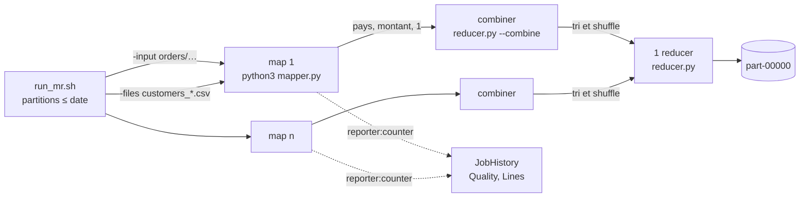
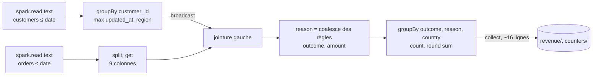

# MapReduce contre Spark (Lot 6)

Le même calcul, le chiffre d'affaires facturé par pays avec un compteur de lignes invalides par
motif, est écrit deux fois : en Hadoop Streaming (mapper et reducer Python) et en Spark. Les deux
programmes lisent les mêmes fichiers bruts du landing et rendent un résultat identique octet pour
octet, vérifié à chaque exécution par un outil de comparaison. Ce document définit le calcul,
décrit les deux implémentations, donne les premières mesures et ce qu'elles prouvent, puis le
protocole et les résultats de la campagne de mesure du lot 7. Stories Jira :
KAN-41 (MapReduce), KAN-42 (Spark), KAN-43 (comparaison).

**En bref.**

- **Résultats égaux, prouvé.** Même CA au centime et mêmes compteurs sur les données du contrat,
  en local et sur le cluster, et en local sur des octets hors contrat (BOM, fins de ligne CR LF
  ou CR, caractère de contrôle dans une région).
- **Durée : MapReduce gagne sur les petits volumes, pas de différence détectable sur 10 M.**
  Campagne de 45 exécutions exclusives, 5 par variante : sur 20 110 lignes, MapReduce met 11,4 s
  (9,8 s avec un battement d'ApplicationMaster de 100 ms) contre 12,7 s pour Spark ; sur 1 M,
  10,8 s pour MapReduce réglé contre 15,5 s pour Spark ; sur 10 M, 21,6 s, 20,7 s et 20,7 s, sans
  différence détectable (test exact de Mann-Whitney, p bilatéral 0,095 et 0,841).
- **Limiteur de MapReduce dans la configuration par défaut : le démarrage échelonné des
  conteneurs**, environ un map par seconde. Démarrés ensemble, ses gros maps finiraient environ
  4 s plus tôt sur 10 M de lignes (inféré de la chronologie des tâches).
- **Ressources : pas de gagnant net sur 10 M.** MapReduce réserve 16 % de mémoire·s en moins,
  Spark 5 % de cœurs·s en moins (médianes de la campagne). Sur 1 M, MapReduce consomme environ
  la moitié des deux.
- **CPU : MapReduce dépense environ 1,7 à 2,0 fois plus de CPU par ligne** sur 10 M de lignes,
  2,0 à 2,2 fois sur 1 M (inféré : la part Python est mesurée hors cluster).
- **Code : même taille** (159 et 180 lignes de code). La différence de lisibilité tient au
  protocole distribué (tri, combiner, format texte, cache distribué) : MapReduce oblige à l'écrire
  à la main, Spark le déduit d'une jointure et d'un `groupBy`.

Détail et tests : [résultats de la campagne](#résultats-de-la-campagne) (3 volumes, 5 exécutions
alternées par variante, cluster exclusif).

## Le calcul

**Entrée.** Les fichiers de commandes de toutes les partitions
`<landing>/orders/ingestion_date=…` jusqu'à une date donnée, et les fichiers clients des
partitions `<landing>/customers/ingestion_date=…` jusqu'à la même date. Les deux moteurs découpent
les fichiers avec le lecteur de lignes de Hadoop (`LineRecordReader`) : une ligne se termine par
LF, CR LF ou CR seul, et un BOM UTF-8 en tête de fichier est ignoré. Le mapper lit son entrée et
les fichiers clients de la même façon. Chaque ligne est découpée sur la virgule, sans gestion de
guillemets : le contrat garantit qu'aucun champ n'est entre guillemets
([précisions du générateur](data-contract.md#précisions-dimplémentation-générateur-100)).
Une ligne dont le premier champ vaut `transaction_id` est un en-tête. Elle est comptée à part et
n'entre pas dans le calcul.

**Pays.** Pour chaque client, la ligne retenue est celle de plus grand `updated_at`, puis de plus
grande région en cas d'égalité (règle déterministe, identique dans les deux moteurs). Le pays est le
préfixe de la région avant `-`, ou `UNKNOWN` si ce préfixe est vide ou contient un caractère de
contrôle ASCII (U+0000 à U+001F, U+007F). Une tabulation couperait la clé que Hadoop trie, et un
caractère inférieur à la tabulation trierait une clé avant la clé qu'elle prolonge. Les lignes
clients qui n'ont pas 8 champs, l'en-tête et les identifiants vides sont ignorés.

**Mesure.** Le montant facturé `quantity × unit_price_eur × (1 − discount_pct)` des lignes
valides de statut `COMPLETED`, sommé par pays. `discount_pct` n'existe que dans les fichiers de J3 ;
absent ou vide, il vaut 0. La somme est exacte : entiers en unités de 10⁻⁵ EUR (centimes ×
millièmes de remise) côté MapReduce, `decimal(27,5)` côté Spark. L'arrondi au centime, au demi
supérieur, n'a lieu qu'une fois, sur le total du pays.

**Ce que ce calcul n'est pas.** C'est un CA « fichier brut » : il ne déduplique pas (les doublons
exacts et inter-jours injectés par le générateur comptent deux fois) et ne contrôle ni le produit
ni la date future. Il sert à comparer deux moteurs sur un traitement identique. Le CA de référence
reste l'indicateur `kpi_revenue_daily` de la couche gold, calculé sur silver.

### Règles des lignes invalides

Une ligne est comptée une seule fois, sous la première règle qu'elle enfreint, dans cet ordre.
Les codes reprennent ceux du [contrat de données](data-contract.md#commandes-orders), ce qui permet
de comparer chaque compteur au manifeste du dépôt.

| Ordre | Motif | La ligne est invalide si | Exemple |
| ---: | --- | --- | --- |
| 1 | `MALFORMED_ROW` | elle n'a ni 8 ni 9 champs | `T1;2025-…;C1;…` (1 champ) |
| 2 | `BAD_QUANTITY` | `quantity` ne vérifie pas `[1-9][0-9]{0,8}` (entier > 0, sans zéro de tête) | `0`, `-3`, `abc`, `007` |
| 3 | `BAD_PRICE` | `unit_price_eur` ne vérifie pas `[0-9]{1,8}(\.[0-9]{1,2})?`, ou vaut 0 | `-12.50`, `0.00`, `1.234` |
| 4 | `BAD_TIMESTAMP` | `event_time` ne vérifie pas `[1-9][0-9]{3}-[0-9]{2}-[0-9]{2}T[0-9]{2}:[0-9]{2}:[0-9]{2}`, ou n'est pas une date et heure réelle | `2025/03/04 10:00`, `2025-02-30T10:00:00` |
| 5 | `NULL_CUSTOMER` | `customer_id` est vide | |
| 6 | `UNKNOWN_CUSTOMER` | `customer_id` est absent des fichiers clients lus | `C999123` |
| 7 | `BAD_ENUM` | `channel` ∉ {`web`, `store`, `partner`} ou `status` ∉ {`COMPLETED`, `CANCELLED`, `RETURNED`} | `fax`, `UNKNOWN` |
| 8 | `BAD_DISCOUNT` | `discount_pct` est présent, non vide, et ne vérifie pas `0\.[0-9]{3}` ou dépasse 0,300 | `0.5`, `0.301` |

Les lignes valides d'un autre statut sont comptées dans `Lines.OTHER_STATUS`, les lignes valides
`COMPLETED` dans `Lines.COMPLETED`, les en-têtes dans `Lines.HEADER` : la somme de tous les
compteurs vaut le nombre de lignes lues. `BAD_DISCOUNT` ne figure pas dans la liste du cadrage. Il
rend le mapper total (une remise illisible ne fait jamais échouer une tâche) et reprend la règle
de silver ([modèle de données](data-model.md#règles-de-qualité-et-disposition)). Le générateur
n'injecte aucune remise invalide, le compteur vaut donc 0 sur les données du projet.

Trois détails rendent les règles identiques dans les deux langages, chacun couvert par un test :

- `[0-9]` et non `\d` : en Python, `\d` accepte tous les chiffres Unicode ;
- l'année commence par `[1-9]` : Spark accepte l'année 0000, Python la refuse ;
- côté Spark, les motifs sont ancrés par `\A…\z` : en Java, `$` accepte aussi un séparateur de
  ligne Unicode (U+2028) final, que `re.fullmatch` refuse.

### Limites connues

Deux cas hors contrat donnent encore des résultats différents. Aucun n'arrive sur les données du
projet, et la couche bronze rejette déjà le premier.

- **UTF-8 invalide.** Python remplace une séquence invalide par un U+FFFD par sous-partie maximale,
  le décodeur Java de Spark parfois par un seul : le substitut CESU-8 `ED A0 80` donne 3 U+FFFD
  en Python et 1 en Java. Un identifiant client ou une région qui contient de tels octets peut
  donc joindre ou s'écrire autrement dans les deux moteurs.
- **U+FEFF en tête d'un split.** Le mapper ignore un U+FEFF au début de son entrée. Hadoop retire
  déjà le BOM en tête de fichier, mais un U+FEFF en tête de la première ligne d'un split autre que
  le premier serait retiré par le mapper et gardé par Spark.

## Deux implémentations

### Hadoop Streaming



- `run_mr.sh` liste les partitions jusqu'à la date, passe chaque répertoire de commandes en
  `-input` et envoie les fichiers clients à chaque tâche par le cache distribué (`-files`).
- `mapper.py` charge les clients en mémoire au démarrage (jointure côté map), classe chaque ligne
  par la table `INVALID_RULES` et écrit `pays<TAB>montant<TAB>1` pour chaque ligne valide
  `COMPLETED`. Il agrège ses compteurs et les déclare une fois à la fin de la tâche, une ligne
  `reporter:counter:<groupe>,<nom>,<n>` par compteur sur stderr.
- `reducer.py` somme par pays les enregistrements triés par Hadoop. Avec `--combine`, il écrit au
  format du mapper (montant en 10⁻⁵ EUR) : c'est le combiner, qui peut s'appliquer plusieurs fois
  sans changer le résultat. Sans option, il convertit en euros arrondis : c'est le reducer.
- Un seul reducer : il n'y a que 6 clés.

### Spark



- Le job `revenue-by-country-spark` (couche `perf`) lit les mêmes partitions, que
  `landed_partitions` liste avec la même règle que `run_mr.sh`.
- Les règles sont la même table, `INVALID_RULES`, écrite en expressions Spark natives (`rlike`,
  `try_cast`, `isin`) ; `reason` vaut la première règle en échec (`coalesce` de `when`). `try_cast`
  rend `NULL` au lieu d'échouer, même avec `spark.sql.ansi.enabled`. Aucune UDF Python.
- Une seule agrégation `groupBy(outcome, reason, country)` donne à la fois le CA par pays et tous
  les compteurs, en un seul passage sur les commandes. Le résultat, une quinzaine de lignes, est
  rapatrié sur le driver puis écrit dans le format texte du reducer.
- Les compteurs sont des agrégats et non des accumulateurs : un accumulateur mis à jour dans une
  transformation compte deux fois les lignes d'une tâche relancée (échec, spéculation), et il
  faudrait du code Python par ligne (`foreach`) pour l'incrémenter.

## Preuve d'égalité des résultats

**En local** (`scripts/test.sh tests/mapreduce`, 65 tests), les deux moteurs traitent les mêmes
fichiers. Le tube MapReduce donne chaque fichier de commandes à son propre mapper,
`python3 mapper.py <clients> < <fichier>`, comme Hadoop donne chaque split à sa propre tâche ;
`cat a b | mapper.py` collerait la dernière ligne d'un fichier sans saut de ligne final à la
première du suivant.

- Un dépôt écrit à la main, 56 lignes, couvre chaque règle et ses cas limites : ligne vide,
  séparateur `;`, 10 champs, `007`, quantité suivie de U+2028, `1.234`, `0.00`, 30 février,
  année 0000, 29 février 2024 valide, `…Z` final, ligne à 8 champs dans un fichier à 9 colonnes,
  client mis à jour dans un second fichier, égalité d'`updated_at`, région `-XX`, préséance de
  deux règles. Le CA attendu est écrit dans le test. Pour DE, 0,03 + 0,045 + 0,045 donne 0,12,
  alors qu'un arrondi par ligne donnerait 0,13. Pour UK, 0,045 donne 0,05 au demi supérieur.
  MapReduce (vrai tube `mapper.py | sort | reducer.py`) et Spark (session locale) rendent
  exactement ces valeurs, Spark aussi avec `spark.sql.ansi.enabled=true`.
- Des fichiers d'octets hors contrat donnent le résultat attendu dans les deux moteurs : BOM devant
  l'en-tête des commandes ou des clients, fins de ligne CR LF et CR seul, fichier sans saut de
  ligne final, tabulation, U+0001 ou U+007F dans une région. Le mapper lu sur le fichier brut rend
  aussi la même sortie et les mêmes compteurs que nourri des lignes que le `TextInputFormat` de
  Hadoop (`sc.textFile`, l'ancienne API qu'utilise Streaming) tire de ce fichier.
- Le combiner appliqué à la sortie de chaque fichier puis le reducer donnent le même résultat que
  le reducer seul.
- Sur les drops J1 à J3 du profil `ci` (20 000 + 2 × 55 lignes), les sorties sont identiques, les
  compteurs `Quality` égaux aux anomalies des manifestes, et les compteurs couvrent toutes les
  lignes.
- Le job enregistré, lancé sur un landing local, écrit la sortie du tube MapReduce.

**Sur le cluster**, `compare.sh` vérifie à chaque exécution que :

- les répertoires lus sont les mêmes. Pour MapReduce, ce sont `mapreduce.input.fileinputformat.inputdir`
  et `tmpfiles`, relus dans la configuration du job (API JobHistory) ; pour Spark, les fichiers
  `inputFiles()` et les répertoires clients journalisés par le job ;
- la sortie de CA de chaque exécution est identique, octet pour octet, à celle de la première
  exécution MapReduce (`hdfs dfs -cat` des fichiers `part-*`), et chaque compteur est égal ;
- la somme des compteurs vaut `Map input records` : aucune ligne perdue ni comptée deux fois ;
- les compteurs `Quality` sont égaux, motif par motif, aux anomalies `orders` non nulles des
  manifestes.

Les 12 exécutions mesurées (2 volumes × 2 moteurs × 3) ont passé ces contrôles, la sortie étant
alors comparée après lecture en décimales. Une sortie MapReduce et une sortie Spark du profil
`dev` ont aussi été comparées par `diff` : identiques. Depuis la comparaison octet pour octet, une
exécution de contrôle sur `dev` (2026-11-26 19:47 UTC, commit `4a80471`, MapReduce, MapReduce
réglé et Spark) donne trois sorties identiques octet pour octet. Résultat commun sur le profil
`full` (J1 à J3, 10 054 794 lignes de données) :

| Pays | CA facturé (EUR) | Lignes `COMPLETED` |
| --- | ---: | ---: |
| DE | 6 032 933 271,06 | 1 349 183 |
| ES | 6 130 969 854,42 | 1 369 109 |
| FR | 17 422 094 258,86 | 3 890 383 |
| IT | 5 592 770 351,66 | 1 249 510 |
| UK | 5 807 140 524,12 | 1 298 215 |
| UNKNOWN | 433 226 117,01 | 96 614 |

| Compteur | Valeur | Manifestes J1 + J2 + J3 |
| --- | ---: | ---: |
| `Quality.MALFORMED_ROW` | 10 054 | 10 000 + 27 + 27 |
| `Quality.BAD_QUANTITY` | 50 274 | 50 000 + 137 + 137 |
| `Quality.BAD_PRICE` | 20 110 | 20 000 + 55 + 55 |
| `Quality.BAD_TIMESTAMP` | 30 164 | 30 000 + 82 + 82 |
| `Quality.NULL_CUSTOMER` | 50 274 | 50 000 + 137 + 137 |
| `Quality.UNKNOWN_CUSTOMER` | 30 164 | 30 000 + 82 + 82 |
| `Quality.BAD_ENUM` | 20 110 | 20 000 + 55 + 55 |
| `Lines.COMPLETED` | 9 253 014 | |
| `Lines.OTHER_STATUS` | 590 630 | |
| `Lines.HEADER` | 3 | |

Sur le profil `dev` (1 005 480 lignes), le CA vaut par exemple 1 767 230 531,51 EUR pour FR et
les compteurs `Quality` 21 114 lignes, égaux aux manifestes.

## Mesures

### Méthode

`scripts/mapreduce/compare.sh` lance les deux moteurs en alternance, 3 fois chacun, sur deux
volumes : le profil `dev` déposé dans le landing (J1 à J3, 1 005 480 lignes, 72 Mo) et le profil
`full` déposé sous `/benchmarks/mr-vs-spark/full` (J1 à J3, 10 054 794 lignes, 717 Mo). Chaque
nombre vient d'une source unique, sans mesure manuelle :

| Mesure | MapReduce | Spark |
| --- | --- | --- |
| Durée | `elapsedTime` de l'application, API REST du ResourceManager | idem |
| Dont jobs | `finishTime − startTime` du job, API REST JobHistory | première soumission à dernière fin de job, API REST du History Server |
| Lignes lues | compteur `Map input records` | somme des `inputRecords` des étapes |
| Octets lus | compteur `HDFS: Number of bytes read` | somme des `inputBytes` des étapes |
| Octets de shuffle | compteur `Reduce shuffle bytes` | somme des `shuffleWriteBytes` des étapes |
| Tâches | maps et reduces lancés, tentatives spéculatives comprises | tâches terminées |
| Mo·s | `memorySeconds` du ResourceManager, relu jusqu'à ce que deux lectures à 5 s d'intervalle soient égales : mémoire réservée, pas consommée | idem |
| Cœurs·s | ApplicationMaster sur la durée, plus un cœur par tentative de tâche (`VCORES_MILLIS_MAPS` et `VCORES_MILLIS_REDUCES`) | ApplicationMaster sur la durée, plus les cœurs de chaque exécuteur sur sa vie (History Server, de l'enregistrement au retrait ou à la fin) |
| Coût d'une tâche | droite des moindres carrés du CPU (`CPU_MILLISECONDS`) et de la durée de chaque map contre ses lignes lues | idem pour les tâches de l'étape qui lit les commandes (`executorCpuTime`, `executorRunTime`) |

Les `vcoreSeconds` du ResourceManager ne servent pas de mesure de CPU : avec le
`DefaultResourceCalculator` de la plateforme, YARN ne planifie que la mémoire et compte un vcore
par conteneur, alors qu'un exécuteur Spark fait tourner 2 tâches à la fois. Le driver Spark en mode
client et le client `hadoop jar` tournent hors de YARN et ne sont comptés ni l'un ni l'autre.

Chaque exécution démarre quand le ResourceManager ne liste plus aucune application active, et
l'outil vérifie après coup qu'aucune autre application ne l'a chevauchée (sinon il la recommence).
Le contrôle est noté avec l'heure dans le rapport de chaque exécution. Les deux moteurs tournent
avec les tailles par défaut de la plateforme ([budget mémoire](platform.md#budget-mémoire)) :
conteneurs map et reduce de 512 Mo et ApplicationMaster de 768 Mo pour MapReduce, 2 exécuteurs de
2 cœurs (1 280 Mo réservés chacun) et un ApplicationMaster de 896 Mo pour Spark, driver en mode
client.

La durée YARN commence à la soumission de l'application. Elle exclut, pour les deux moteurs, ce
que fait le client avant : démarrage de la JVM de `hadoop jar` et calcul des splits pour
MapReduce, démarrage du driver et création du `SparkContext` pour Spark.

### Résultats

Médiane de 3 exécutions exclusives par moteur et par volume ; entre parenthèses, le minimum et le
maximum. Toutes les exécutions datent du 2026-11-26, entre 18:43 et 18:49 UTC, au commit
`5e53e26`. Les ressources ont été relues le même jour à 19:46 UTC avec `compare.sh --reread`,
une fois stables : les premières lectures, faites dès la fin du job, sous-estimaient de 4 à 11 %
les Mo·s de chaque application MapReduce.

| Volume | Moteur | Durée (s) | Dont jobs (s) | Mo·s | Cœurs·s | Lignes lues | Octets lus | Octets de shuffle | Tâches |
| --- | --- | ---: | ---: | ---: | ---: | ---: | ---: | ---: | ---: |
| `dev`, 1,0 M lignes | MapReduce | **13,6** (12,7 à 14,3) | 10,5 | 23 338 | 25,6 | 1 005 483 | 71 743 468 | 616 | 5 |
| `dev`, 1,0 M lignes | Spark | **14,9** (12,7 à 16,4) | 6,3 | 45 040 | 50,7 | 1 010 649 | 72 363 107 | 61 723 | 12 |
| `full`, 10,1 M lignes | MapReduce | **19,6** (18,2 à 20,4) | 17,3 | 53 277 | 72,5 | 10 054 797 | 717 495 123 | 1 353 | 9 |
| `full`, 10,1 M lignes | Spark | **16,5** (16,5 à 18,6) | 10,1 | 58 304 | 65,8 | 10 059 963 | 718 359 432 | 64 276 | 14 |

Détail des 12 exécutions, tel que le ResourceManager le rend une fois stable :

| Application | Volume | Moteur | `elapsedTime` (ms) | `memorySeconds` | `vcoreSeconds` | Cœurs·s |
| --- | --- | --- | ---: | ---: | ---: | ---: |
| `application_1795715756506_0023` | `dev` | MapReduce | 13 625 | 23 338 | 33 | 25,6 |
| `application_1795715756506_0024` | `dev` | Spark | 14 855 | 43 698 | 36 | 50,7 |
| `application_1795715756506_0025` | `dev` | MapReduce | 14 338 | 24 169 | 34 | 26,9 |
| `application_1795715756506_0026` | `dev` | Spark | 16 352 | 52 009 | 44 | 53,0 |
| `application_1795715756506_0027` | `dev` | MapReduce | 12 697 | 23 039 | 33 | 22,8 |
| `application_1795715756506_0028` | `dev` | Spark | 12 729 | 45 040 | 37 | 45,8 |
| `application_1795715756506_0029` | `full` | MapReduce | 18 205 | 50 974 | 82 | 68,4 |
| `application_1795715756506_0030` | `full` | Spark | 18 602 | 63 570 | 53 | 69,9 |
| `application_1795715756506_0031` | `full` | MapReduce | 20 419 | 55 218 | 89 | 76,6 |
| `application_1795715756506_0032` | `full` | Spark | 16 524 | 58 304 | 49 | 65,8 |
| `application_1795715756506_0033` | `full` | MapReduce | 19 556 | 53 277 | 86 | 72,5 |
| `application_1795715756506_0034` | `full` | Spark | 16 459 | 57 456 | 48 | 64,8 |

**Aucune différence de durée n'est démontrée.** Test exact de Mann-Whitney sur les durées, par
volume :

| Volume | Paires où MapReduce est plus lent | p unilatéral (Spark plus rapide) | p bilatéral |
| --- | ---: | ---: | ---: |
| `dev` | 2 sur 9 | 0,90 | 0,40 |
| `full` | 8 sur 9 | 0,10 | 0,20 |

Le p bilatéral double la plus petite des deux queues. Avec 3 exécutions contre 3, le plus petit p
unilatéral possible vaut 1/20 = 0,05 : même un classement parfait n'atteindrait que ce seuil. Sur
`full`, l'avance médiane de Spark (3,0 s) n'est donc pas significative ; sur `dev`, l'écart va dans
l'autre sens et reste dans la dispersion. L'écart relatif (max − min) / médiane de chaque moteur va
de 11 % à 24 %.

### Ce que disent ces chiffres

**Lignes et octets lus.** Les deux moteurs lisent les mêmes lignes de commandes : 10 054 797 =
10 054 794 lignes de données + 3 en-têtes. Spark compte en plus les 5 166 lignes des fichiers
clients, qu'il lit dans HDFS, alors que chaque mapper MapReduce les reçoit du cache distribué, hors
compteurs. Pour les octets, les commandes du profil `full` font 717 473 355 octets. MapReduce en
lit 21 768 de plus (fin de la dernière ligne de chaque split, et la description des splits) ;
Spark 886 077 de plus, soit les 558 397 octets des fichiers clients et 327 680 octets (5 × 64 Kio)
lus au-delà des 5 frontières de split du fichier J1.

**Shuffle.** Le mapper émet une ligne par commande valide `COMPLETED` (9 253 014 enregistrements
sur `full`), que le framework trie et déverse sur disque avant que le combiner les ramène à 6 par
tâche : 48 enregistrements, 1 353 octets envoyés au reducer. Spark agrège dans chaque tâche
avant le shuffle, sans tri : 86 enregistrements partiels. Ses 64 Ko de shuffle viennent surtout de
la déduplication des clients (5 084 enregistrements), un `groupBy` distribué que le mapper fait en
mémoire.

**Où va le temps de MapReduce : le démarrage échelonné des conteneurs.** Chronologie JobHistory du
job `job_1795715756506_0029` : l'ApplicationMaster démarre en 2,3 s, puis les 8 maps démarrent à
+3,1, +4,0, +5,0, +6,0, +7,1, +9,1, +11,1 et +12,1 s après le début du job. Les 5 maps de 128 Mo
(1,88 M lignes chacune) durent chacune 7,6 à 8,5 s, et le dernier gros map, démarré à +7,1 s, fixe
la fin de la phase map vers +15,6 s. Le reducer finit 0,2 s plus tard. La fin de la phase map
dépend donc autant de l'arrivée des conteneurs, environ un par seconde, que du calcul : démarrés
ensemble à +3,1 s, les 5 gros maps auraient fini vers +11,6 s (inféré). Sur le profil
`dev`, J1 ne fait que 2 splits de 36 Mo : Hadoop Streaming passe par l'ancienne API `mapred`, dont
le découpage vise `mapreduce.job.maps` = 2 splits par job.

Deux réglages expliqueraient ce rythme (hypothèse) :

- **le battement ApplicationMaster ↔ ResourceManager**,
  `yarn.app.mapreduce.am.scheduler.heartbeat.interval-ms` = 1 000 ms : l'ApplicationMaster ne
  demande ses conteneurs et ne reçoit ceux qui lui sont attribués qu'une fois par seconde ;
- **l'ordonnancement différé du CapacityScheduler.** Aucun NodeManager ne tourne sur un hôte de
  DataNode, donc tous les maps sont `RACK_LOCAL` (compteur `Rack-local map tasks` égal au nombre
  de maps lancés dans les 6 jobs mesurés). Avec
  les valeurs par défaut (`node-locality-delay` = 40, plafonné au nombre de nœuds, 2, et
  `rack-locality-full-reset` = `true`), chaque attribution `RACK_LOCAL` remet à zéro le compte
  des occasions manquées : un map par paire de battements de NodeManager
  (`yarn.resourcemanager.nodemanagers.heartbeat-interval-ms` = 1 000 ms, 2 nœuds), soit un par
  seconde. Les deux exécuteurs Spark, demandés sans préférence de nœud, s'enregistrent eux à
  0,07 à 0,64 s d'intervalle selon l'exécution.

Un essai unique sur `dev` (2026-11-26 19:47 UTC, cluster libre pour les deux jobs MapReduce)
donne une indication, pas une mesure. Avec un battement de 100 ms, les 4 maps démarrent à +1,7,
+2,5, +3,5 et +3,6 s, contre +3,1, +4,0, +5,0 et +7,1 s avec le réglage par défaut. Le battement de
l'ApplicationMaster explique donc une part du retard, et les écarts d'environ 1 s entre les trois
premiers maps restent, comme le prévoit l'ordonnancement différé. Ce second réglage appartient au
cluster (`capacity-scheduler.xml`) et n'a pas été essayé. La campagne mesure la variante
« battement à 100 ms » ; le verdict de durée ne vaut que pour la configuration qu'elle mesure.

**Où va le temps de Spark.** Chronologie du History Server pour `application_1795715756506_0034` :
les exécuteurs s'enregistrent 5,3 et 5,8 s après le démarrage du `SparkContext`, et le premier job part
à +7,7 s. Lecture et agrégation des clients : 1,5 s. Étape principale (lecture des commandes,
classement, agrégation partielle) : 6 tâches de 128 Mo sur 4 cœurs, 5,4 s. Agrégation finale :
0,1 s. Puis 2,2 s d'écritures : les deux fichiers de sortie et la ligne d'audit, chacune un job
Spark d'une tâche. Le calcul proprement dit prend donc environ 7 s sur 16,5.

**CPU et coût d'une tâche.** Le compteur `CPU time spent` de MapReduce ne voit que la JVM de chaque
tâche : le processus Python, terminé avant la dernière mesure de la tâche, n'y est pas. Une droite
des moindres carrés par exécution, CPU ou durée de chaque tâche contre ses lignes lues, sépare le
coût fixe d'une tâche de son coût par ligne (médiane des 3 exécutions `full`, rapport
`--reread`) :

| Moteur, tâches | CPU fixe par tâche | CPU par M lignes | Durée fixe par tâche | Durée par M lignes |
| --- | ---: | ---: | ---: | ---: |
| MapReduce, 8 maps (JVM seule) | 0,94 s | 0,74 s | 1,89 s | 3,39 s |
| Spark, 6 tâches de l'étape principale | ≈ 0 | 1,47 s | ≈ 0 | 1,60 s |

Le coût fixe d'un map (démarrage de la JVM et du processus Python, chargement des clients) n'a pas
d'équivalent côté Spark, dont les exécuteurs restent démarrés. Le rapport des CPU totaux, environ
2,3 en défaveur de MapReduce, mélange ce coût fixe et le coût par ligne ; la comparaison des
temps de tâche totaux aussi, puisque `MILLIS_MAPS` compte le démarrage de chaque map et
`executorRunTime` ne le compte pas. Seules les pentes se comparent à méthode égale.

Par ligne, à méthode égale :

- **CPU.** Le mapper Python, mesuré à part dans un conteneur client sur les 1 000 001 lignes de J1
  `dev`, consomme 2,1 s de CPU par million de lignes sur une machine calme (ancien mapper,
  3 exécutions), et 2,4 à 3,0 s sur la machine chargée de ce jour (charge 4 à 5 sur 16 cœurs,
  5 exécutions alternées par version : médiane 2,84 s pour l'ancien mapper, 2,66 s pour le
  nouveau, sans différence mesurable). Le combiner consomme 0,26 s par million d'enregistrements,
  soit 0,24 s par million de lignes. Avec 2,1 à 2,7 s pour le mapper (machine calme, médiane du
  nouveau mapper sous charge), MapReduce dépense 0,74 + 2,1 à 2,7 + 0,24 ≈ 3,1 à 3,7 s de CPU par
  million de lignes, contre 1,47 s pour Spark : **2,1 à 2,5 fois plus** sur cette série de 3
  exécutions (valeur inférée, la part Python ne venant pas du cluster). La campagne de 5
  exécutions donne, avec la même formule, 1,7 à 2,0 fois sur `full` et 2,0 à 2,2 fois sur `dev`
  ([résultats de la campagne](#résultats-de-la-campagne)). Chaque ligne passe de la JVM au mapper en texte, et chaque
  enregistrement émis revient à la JVM, part au combiner et en revient : quatre passages d'une
  frontière de processus. La JVM trie aussi les 9,25 M enregistrements. Spark lit et classe
  chaque ligne dans du code JVM généré, puis agrège dans une table de hachage.
- **Durée d'une tâche.** Un map met 3,39 s par million de lignes, une tâche Spark 1,60 s : 2,1
  fois plus.

**Pourquoi MapReduce reste proche malgré ce surcoût (inféré).** Il a 2 fois plus de tâches en
parallèle : jusqu'à 8 conteneurs map de 512 Mo à la fois, contre 4 cœurs pour les 2 exécuteurs
Spark. Deux fois plus de tâches, chacune environ deux fois plus lente par ligne : les deux
s'équilibrent, et le démarrage échelonné des maps décide du reste.

**Ressources.** Mémoire réservée (Mo·s), la seule ressource que YARN planifie ici, et cœurs·s
détenus, en médiane des 3 exécutions de cette série. La campagne de 5 exécutions remplace ces
chiffres sur `full` : MapReduce −16 % de Mo·s, Spark −5 % de cœurs·s
([résultats de la campagne](#résultats-de-la-campagne)).

| Volume | Mo·s MapReduce | Mo·s Spark | Écart | Cœurs·s MapReduce | Cœurs·s Spark | Écart |
| --- | ---: | ---: | ---: | ---: | ---: | ---: |
| `dev` | 23 338 | 45 040 | MapReduce −48 % | 25,6 | 50,7 | MapReduce −49 % |
| `full` | 53 277 | 58 304 | MapReduce −9 % | 72,5 | 65,8 | Spark −9 % |

MapReduce rend chaque conteneur à la fin de sa tâche ; Spark garde ses deux exécuteurs pendant
toute l'application, démarrage et écritures compris. Sur `dev`, ces exécuteurs attendent plus
qu'ils ne calculent, d'où le double. Sur `full`, MapReduce réserve moins de mémoire mais détient
plus de cœurs, parce que ses maps tournent plus longtemps par ligne. Les `vcoreSeconds` bruts
donneraient 43 % de moins pour Spark sur `full` (49 contre 86), en comptant un vcore pour un
exécuteur de 2 cœurs comme pour un map d'un cœur.

## Taille et lisibilité du code

Compté par `compare.sh` sur le code formaté par `ruff`. Les lignes de code excluent les lignes
vides, les commentaires et les docstrings.

| Moteur | Fichier | Lignes | Lignes de code |
| --- | --- | ---: | ---: |
| MapReduce | `mapreduce/mapper.py` | 157 | 101 |
| MapReduce | `mapreduce/reducer.py` | 44 | 23 |
| MapReduce | `scripts/mapreduce/run_mr.sh` | 57 | 35 |
| **MapReduce** | **total** | **258** | **159** |
| Spark | `src/gtdp/perf/revenue_by_country.py` | 162 | 117 |
| Spark | `src/gtdp/jobs/revenue_by_country.py` | 77 | 63 |
| **Spark** | **total** | **239** | **180** |

Spark ne gagne rien en nombre de lignes, et le décompte par rôle explique pourquoi. Classement à
la main, par plages de lignes, des mêmes lignes de code :

| Rôle | MapReduce | Spark |
| --- | ---: | ---: |
| Règles, constantes, montant (imports compris) | 64 | 81 |
| Jointure avec les clients | 19 | 22 |
| Agrégation, arrondi | 16 | 4 |
| Entrées-sorties : protocole Streaming / format texte du reducer | 25 | 10 |
| Orchestration : `run_mr.sh` / job (partitions, écritures, audit, journal) | 35 | 63 |
| **Total** | **159** | **180** |

- **Les règles pèsent autant des deux côtés.** C'est le cœur du calcul, une table de 8 règles. En
  Spark, chaque règle est une expression de colonnes que `ruff` étale sur plusieurs lignes, et la
  liste des 9 colonnes occupe 11 lignes.
- **L'agrégation n'existe presque pas en Spark** (`groupBy`, `count`, `round(sum)`, 4 lignes).
  En MapReduce, elle demande un programme à part, un format d'échange, un mode combiner et un
  arrondi entier écrit à la main.
- **Le job Spark fait plus que le calcul.** Il s'inscrit dans la plateforme : configuration, ligne
  d'audit, journal JSON, et réécriture de son résultat au format du reducer pour la comparaison
  octet par octet. Sans ces adaptations (une vingtaine de lignes), il serait le plus court.

La lisibilité tient moins au nombre de lignes qu'à ce qu'un relecteur doit savoir pour se
convaincre que le résultat est juste :

| Pour vérifier… | MapReduce | Spark |
| --- | --- | --- |
| l'agrégation | Hadoop trie par la clé, le texte avant la première tabulation ; un reducer reçoit toutes les valeurs d'une clé à la suite ; le combiner peut s'appliquer 0, 1 ou n fois, donc il doit garder le format de son entrée (d'où `--combine`) | `groupBy` puis `agg` |
| l'exactitude au centime | les montants traversent des processus en texte, donc des entiers en 10⁻⁵ EUR, et l'arrondi est réécrit (`(u + 500) // 1000`) | types `decimal`, `round` au demi supérieur |
| la jointure | `-files` dépose chaque fichier sous son nom de base dans le répertoire de la tâche, et le mapper les charge tous avant la première ligne | `broadcast` et une jointure gauche |
| les compteurs | syntaxe `reporter:counter:` sur stderr, agrégation par Hadoop des valeurs des tâches réussies seulement | un compte par groupe, rien d'implicite |
| la lecture des lignes | le mapper doit relire chaque fichier comme le lecteur de Hadoop (CR, CR LF, BOM) pour que le tube local prouve ce que fait le cluster | `spark.read.text` passe par ce lecteur |
| les cas limites | Python pur : `python3 mapper.py … < fichier` suffit à déboguer, sans cluster ni JVM | logique ternaire de `NULL` : une condition `NULL` n'est pas vraie, d'où `isNull()` dans `BAD_TIMESTAMP` et l'ordre des règles ; il faut une `SparkSession` locale (10 s de démarrage dans les tests) |

Chaque moteur a donc sa difficulté. En MapReduce, elle est dans la plomberie distribuée, qu'il
faut écrire et dont les contrats sont implicites. En Spark, elle est dans la sémantique des
expressions de colonnes. Elle se teste localement, et le plan d'exécution (jointure diffusée,
agrégation partielle) est choisi par l'optimiseur.

## Arbitrage complexité contre performance

**Les optimisations coûtent du code en MapReduce et rien en Spark.** Les deux programmes
appliquent les mêmes optimisations : jointure côté map plutôt qu'un second job, agrégation avant le
shuffle, un seul passage sur les données. En MapReduce, chacune est écrite à la main : le cache
distribué et le dictionnaire en mémoire, le combiner et son format, les compteurs agrégés en fin de
tâche. En Spark, la jointure côté map tient dans un appel à `broadcast`, et l'optimiseur ajoute
seul l'agrégation partielle.
L'optimisation suivante montre la même asymétrie. En MapReduce, l'agrégation dans le mapper
(sommer en mémoire et émettre 6 enregistrements par tâche au lieu de 1,88 M) supprimerait le tri,
les déversements et le combiner : les 0,24 s de CPU du combiner par million de lignes et une part
du CPU de la JVM (hypothèse non mesurée), au prix d'une logique de plus dans le mapper. Spark le
fait déjà.

**Les deux moteurs ne paient pas au même endroit.**

- MapReduce paie à chaque tâche : 0,94 s de CPU de JVM et 1,9 s de durée fixes par map, puis un
  coût par ligne environ deux fois celui de Spark (CPU et durée), dû au passage des lignes en texte
  entre processus et au tri. Ses conteneurs arrivent au rythme d'un par seconde avec les réglages
  par défaut.
- Spark paie une fois au démarrage : driver, ApplicationMaster, deux exécuteurs, 7,7 s avant le
  premier job. Ses tâches n'ont ensuite presque aucun coût fixe.
- Sur 1 M et 10 M lignes, ces coûts s'équilibrent dans la dispersion des mesures. Une droite de
  durée par moteur tirée de ces deux volumes ne donne pas de volume de bascule : avec une
  exécution par point, le croisement des deux droites va de −201 M à +40 M de lignes selon les
  exécutions retenues. La campagne ajoute un troisième volume et 5 exécutions par point.

**Ressources.** Sur `full`, aucun moteur n'est plus économe : dans la campagne, MapReduce réserve
16 % de mémoire·s en moins, Spark détient 5 % de cœurs·s en moins. Sur `dev`, MapReduce consomme la moitié des deux,
parce que Spark garde ses exécuteurs pendant le démarrage et les écritures. Sur ce cluster, YARN ne
planifie que la mémoire.

**Ce que la mesure ne dit pas.** Deux volumes, trois exécutions chacun, sur une seule machine où
les « nœuds » partagent les mêmes 16 cœurs. Les deux moteurs tournent avec les réglages par défaut
de la plateforme ; donner à Spark un troisième exécuteur (la mémoire le permet), ou à MapReduce un
battement plus court, changerait les durées. Le coût CPU par ligne, lui, ne dépend pas du
parallélisme.

## Campagne de mesure

Protocole de la mesure qui tranche la question de la durée, lancée avec le lot 7 sur un cluster
réservé. Résultats à la fin de la section.

- **Volumes.** Trois profils du générateur, graine 42, J1 à J3 avec leurs manifestes : `ci`
  (20 110 lignes, presque tout en coûts fixes), `dev` (1,0 M, déjà dans le landing) et `full`
  (10,1 M). `ci` et `full` sont déposés sous `/benchmarks/mr-vs-spark/<profil>/landing`.
- **Variantes.** `mapreduce` (réglages par défaut), `mapreduce-tuned` (battement
  ApplicationMaster ↔ ResourceManager à 100 ms, `--mr-conf`) et `spark` (réglages par défaut,
  2 exécuteurs de 2 cœurs).
- **Exécutions.** 5 par variante et par volume, en alternance (`mapreduce`, `mapreduce-tuned`,
  `spark`, puis on recommence), soit 45 exécutions, 28 minutes mesurées.
- **Exclusivité.** Chaque exécution attend que le ResourceManager ne liste plus aucune application
  active ; une exécution qu'une autre application a chevauchée est recommencée (3 essais au
  plus) ; le contrôle est noté dans le rapport. Prévenir les autres lots : le streaming ne doit pas
  tourner pendant la campagne.
- **Contrôles.** À chaque exécution, sortie identique octet pour octet, compteurs égaux et égaux
  aux manifestes ; l'outil sort en erreur sinon.
- **Test.** Par volume et par paire de variantes, test exact de Mann-Whitney sur les durées. Une
  différence est retenue si le p bilatéral est inférieur à 0,05 (avec 5 exécutions contre 5, le
  plus petit p bilatéral possible vaut 0,008) ; le rapport donne aussi la médiane et l'étendue.
  Les ressources sont relues une fois stables, et le coût d'une tâche est ajusté à chaque
  exécution.
- **Option, sur décision du lead.** Pour tester l'ordonnancement différé, une série
  supplémentaire avec `yarn.scheduler.capacity.rack-locality-full-reset=false` dans
  `capacity-scheduler.xml`, puis `yarn rmadmin -refreshQueues`. C'est un changement de la
  plateforme, à annuler ensuite.

```bash
export GTDP_PSEUDO_SALT=<valeur hors dépôt>
scripts/perf/bench.sh land --profile ci          # orders, customers, products et manifestes de J1 à J3,
scripts/perf/bench.sh land --profile full        # graine 42, sous /benchmarks/mr-vs-spark/<profil>/landing
scripts/mapreduce/compare.sh --date 2026-01-03 --runs 5 \
  --volumes ci=hdfs://namenode:8020/benchmarks/mr-vs-spark/ci/landing \
            dev=hdfs://namenode:8020/datalake/landing \
            full=hdfs://namenode:8020/benchmarks/mr-vs-spark/full/landing \
  --mr-conf yarn.app.mapreduce.am.scheduler.heartbeat.interval-ms=100 \
  --out build/mr-vs-spark/campaign
scripts/cluster/client.sh hdfs dfs -rm -r -skipTrash /benchmarks/mr-vs-spark
```

### Résultats de la campagne

La campagne a tourné le 2026-11-27 de 02:14 à 02:42 UTC, au commit `32b18ba`, avec la commande
ci-dessus : 45 exécutions, `application_1795715756506_0360` à `_0404`. Chacune a démarré quand
le ResourceManager ne listait aucune application active (contrôle noté dans le rapport, par
exemple `2026-11-27T02:14:53+00:00 : 0 application(s) NEW/NEW_SAVING/SUBMITTED/ACCEPTED/RUNNING`),
et aucune n'a été chevauchée par une autre application : aucune n'a donc été recommencée. Sur
chaque volume, les 15 exécutions rendent la même sortie octet pour octet et les mêmes compteurs,
et les compteurs `Quality` sont égaux aux anomalies des manifestes. Les entrées `ci` et `full`
ont été déposées par une boucle `hdfs dfs -put` équivalente à `bench.sh land`, sans les produits,
que `compare.sh` ne lit pas. Rapport complet : sortie de `compare.sh`, versionnée dans
[`docs/perf-evidence/mr-vs-spark-campaign.md`](perf-evidence/mr-vs-spark-campaign.md).

| Volume | Variante | n | Durée médiane (s) | Min à max (s) | p bilatéral contre `spark` | Mo·s médian | Cœurs·s médian | CPU par M lignes (s) |
| --- | --- | ---: | ---: | ---: | ---: | ---: | ---: | ---: |
| `ci`, 20 110 lignes | `mapreduce` | 5 | 11,4 | 11,2 à 11,9 | 0,008 | 19 581 | 19,2 | non significatif |
| `ci` | `mapreduce-tuned` | 5 | **9,8** | 9,6 à 11,3 | 0,008 | 17 902 | 20,3 | non significatif |
| `ci` | `spark` | 5 | 12,7 | 12,4 à 16,8 | — | 43 511 | 46,3 | non significatif |
| `dev`, 1,0 M lignes | `mapreduce` | 5 | 13,8 | 13,0 à 16,0 | 0,056 | 24 475 | 26,8 | 2,00 |
| `dev` | `mapreduce-tuned` | 5 | **10,8** | 9,7 à 11,1 | 0,008 | 20 501 | 25,1 | 1,92 |
| `dev` | `spark` | 5 | 15,5 | 14,5 à 18,7 | — | 53 555 | 54,6 | 2,21 |
| `full`, 10,1 M lignes | `mapreduce` | 5 | 21,6 | 21,2 à 23,1 | 0,095 | 58 800 | 86,3 | 0,95 |
| `full` | `mapreduce-tuned` | 5 | 20,7 | 18,8 à 21,7 | 0,841 | 55 245 | 85,8 | 0,90 |
| `full` | `spark` | 5 | 20,7 | 19,9 à 22,6 | — | 69 741 | 81,9 | 1,92 |

Le CPU par million de lignes vient de la droite des moindres carrés par tâche. Sur `ci`, les
tâches lisent trop peu de lignes (20 110 en tout) pour que la pente ait un sens : la régression
donne même des durées négatives par million de lignes. Côté MapReduce, ce CPU ne compte que les
JVM, pas les processus Python (voir plus haut).

Comparaison des moteurs, variante MapReduce par défaut contre Spark, calculée par
`scripts/mapreduce/compare.sh --summarize docs/perf-evidence/mr-vs-spark-campaign.md` à partir
des médianes de la campagne. Le CPU par ligne de MapReduce ajoute à la pente de ses JVM le mapper
Python (2,1 à 2,7 s par million de lignes) et le combiner (0,24 s), mesurés hors cluster
([CPU et coût d'une tâche](#ce-que-disent-ces-chiffres)) :

| Volume | Mo·s de MapReduce contre Spark | Cœurs·s de Spark contre MapReduce | CPU par ligne, MapReduce / Spark |
| --- | ---: | ---: | ---: |
| `dev` | −54,3 % | +103,7 % | 2,0 à 2,2 |
| `full` | −15,7 % | −5,1 % | 1,7 à 2,0 |

Test de Mann-Whitney exact entre les deux variantes MapReduce : p bilatéral 0,016 sur `ci`,
0,008 sur `dev` et 0,056 sur `full`.

**Ce que la campagne établit.**

- **Petits volumes : MapReduce est plus rapide que Spark**, avec la différence retenue (p < 0,05)
  sur `ci` pour les deux variantes MapReduce, et sur `dev` pour la variante à battement court.
  Spark paie un démarrage fixe (driver, ApplicationMaster, deux exécuteurs) que ces volumes ne
  compensent pas.
- **Le battement court de l'ApplicationMaster MapReduce gagne 1,6 s sur `ci` et 3,0 s sur `dev`**
  (p 0,016 et 0,008) : une part du coût fixe de MapReduce venait de l'attente des conteneurs, comme
  l'annonçait l'essai unique de la section précédente. Sur `full`, le gain (0,9 s) n'est pas
  significatif (p 0,056).
- **Sur 10 M de lignes, aucune différence de durée n'est démontrée** entre Spark et l'une ou
  l'autre variante MapReduce (p 0,095 et 0,841). Le point de bascule se situe donc au-delà de
  `dev` et, au mieux, autour de `full` : la campagne ne montre pas de volume où Spark devient plus
  rapide.
- **Ressources.** Spark réserve 2,2 fois plus de mémoire·s que MapReduce sur `ci` et `dev`, et
  1,2 fois plus sur `full`. Ses cœurs·s dépassent ceux de MapReduce de 2,4 fois sur `ci`, 2,0 fois
  sur `dev`, et sont 5 % plus bas sur `full`.

L'option `rack-locality-full-reset=false` n'a pas été essayée : c'est un changement de la
plateforme, que le lead n'a pas demandé.

## Conclusion

Ce que les mesures établissent aujourd'hui :

1. **Même résultat**, au centime et compteur par compteur, vérifié à chaque exécution, égal aux
   manifestes du générateur, et identique sur les octets hors contrat testés.
2. **MapReduce est plus rapide sur les petits volumes, et aucun moteur ne l'est sur 10 M de
   lignes** (campagne de 5 exécutions par variante). Spark paie un démarrage fixe que 20 000 et
   1 M de lignes ne compensent pas. MapReduce est limité par l'arrivée de ses conteneurs autant
   que par son calcul : un battement d'ApplicationMaster de 100 ms lui fait gagner 1,6 à 3,0 s
   sur les petits volumes.
3. **Plus de CPU par ligne pour MapReduce**, environ 1,7 à 2,0 fois sur 10 M de lignes (inféré,
   campagne), et un coût fixe par tâche que Spark n'a pas ; en contrepartie, MapReduce réserve
   moins de mémoire (16 % de moins sur 10 M de lignes).
4. **Moins de plomberie à écrire et à relire en Spark.** À taille égale, le code Spark décrit le
   calcul, alors que le code MapReduce décrit aussi le protocole distribué (tri, combiner, cache,
   format texte, arithmétique entière, lecture des lignes). Il s'intègre de plus au cadre commun :
   configuration, audit, tests en Spark local.

Les traitements batch de la plateforme sont écrits en Spark, pour les points 3 et 4 et non pour
une vitesse que les mesures ne montrent pas. MapReduce garde de vrais atouts : un mapper en Python
standard qu'on débogue avec un simple tube, sans cluster, et une mémoire réservée au plus juste,
tâche par tâche. Le job Hadoop Streaming reste dans le dépôt comme référence de la comparaison.
La campagne ne montre aucun volume, jusqu'à 10 M de lignes, où Spark serait plus rapide.

## Reproduire

Commandes complètes : [runbook](runbook/mapreduce.md).

```bash
export GTDP_PSEUDO_SALT=<valeur hors dépôt>
scripts/test.sh tests/mapreduce                                   # tests locaux, deux moteurs
scripts/mapreduce/compare.sh --date 2026-01-03                    # landing, 5 exécutions par moteur
p=application_1795715756506_                                      # relecture des 12 exécutions
scripts/mapreduce/compare.sh --out build/mr-vs-spark/reread --reread \
  dev=${p}0023,${p}0024,${p}0025,${p}0026,${p}0027,${p}0028 \
  full=${p}0029,${p}0030,${p}0031,${p}0032,${p}0033,${p}0034
```
