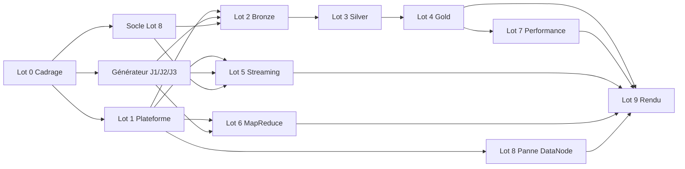

# Pilotage du projet

## Outils

| Besoin | Outil |
| --- | --- |
| Backlog Kanban, suivi des jalons | Jira, projet [KAN](https://projet-bigdata-3il.atlassian.net/jira/software/projects/KAN/boards/1) |
| Code, revues, CI | GitHub (ce dépôt), GitHub Actions |
| Décisions | [`docs/adr/`](adr/) |

Le tableau Kanban suit le cycle d'une PR : **À faire** → **En cours** (branche ouverte) →
**En cours de revue** (PR ouverte, CI verte) → **Terminé** (PR fusionnée).

## Découpage

Une epic Jira par lot du sujet (Lot 0 à Lot 9), une story par livrable vérifiable. Chaque story
a ses critères d'acceptation, un libellé de rôle et un jalon (version Jira J1 à J4).

## Rôles

Le projet est réalisé par un pilote et des agents de développement (méthode
[pstack](https://github.com/cursor/plugins/tree/main/pstack), mode *poteto*) : le pilote conçoit,
découpe, relit et fusionne ; chaque story est confiée à un agent dans sa propre branche et son
propre worktree. Les rôles du sujet sont attribués ainsi :

| Rôle | Responsabilité principale | Lots | Tenu par |
| --- | --- | --- | --- |
| Architecte plateforme | Cluster, HDFS, bronze, volet HDFS de la performance | 1, 2, 7 (HDFS) | agent plateforme, agent bronze |
| Data engineer batch | Silver, gold | 3, 4 | agent silver, agent gold |
| Data engineer streaming et performance | Streaming, MapReduce contre Spark, benchmarks | 5, 6, 7 | agent streaming, agent MapReduce, agent performance |
| Responsable qualité et delivery | Cadrage, industrialisation, rendu, suivi | 0, 8, 9 | pilote, agent socle, agent documentation |

## Revues

Aucune relecture humaine : chaque livrable passe une **revue adverse** par deux relecteurs
indépendants sur deux modèles différents (méthode *interrogate*), chacun dans la peau d'un rôle
différent de celui de l'auteur. Un constat n'est retenu que s'il est prouvé par une exécution
(test qui échoue, script de reproduction, calcul) ; le pilote relance chaque constat avant de le
retenir. Les constats vérifiés sont publiés sur la PR, corrigés avant fusion, et la revue est
archivée dans [`docs/reviews/`](reviews/).

## Jalons

| Jalon | Livrable | Date prévue |
| --- | --- | --- |
| J1 | Cadrage validé, cluster opérationnel, ingestion de J1 | 2026-12-04 |
| J2 | Silver complète, tests, première CI, ingestion de J2 | 2026-12-11 |
| J3 | Gold, streaming, MapReduce contre Spark, ingestion de J3 | 2026-12-18 |
| J4 | Benchmark, runbook, rapport final, soutenance | 2027-01-08 |

## Ordre de réalisation

Les dépendances fixent l'ordre ; ce qui ne partage aucun fichier avance en parallèle.

## Définition de « terminé »

Une story est terminée quand :

1. le code est sur `main` via une PR au titre `type(scope): sujet`, référencée `KAN-xx` ;
2. la CI est verte (lint, tests) ;
3. la revue adverse est passée et ses constats vérifiés sont corrigés ;
4. les critères d'acceptation de la story sont démontrés sur le cluster (YARN), preuve dans la PR,
   et cochés dans Jira avec un lien vers cette preuve ;
5. la documentation concernée est à jour.
